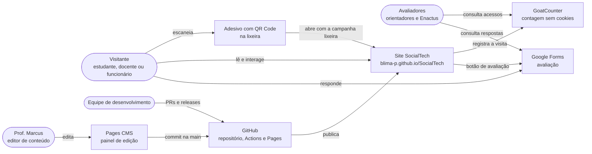
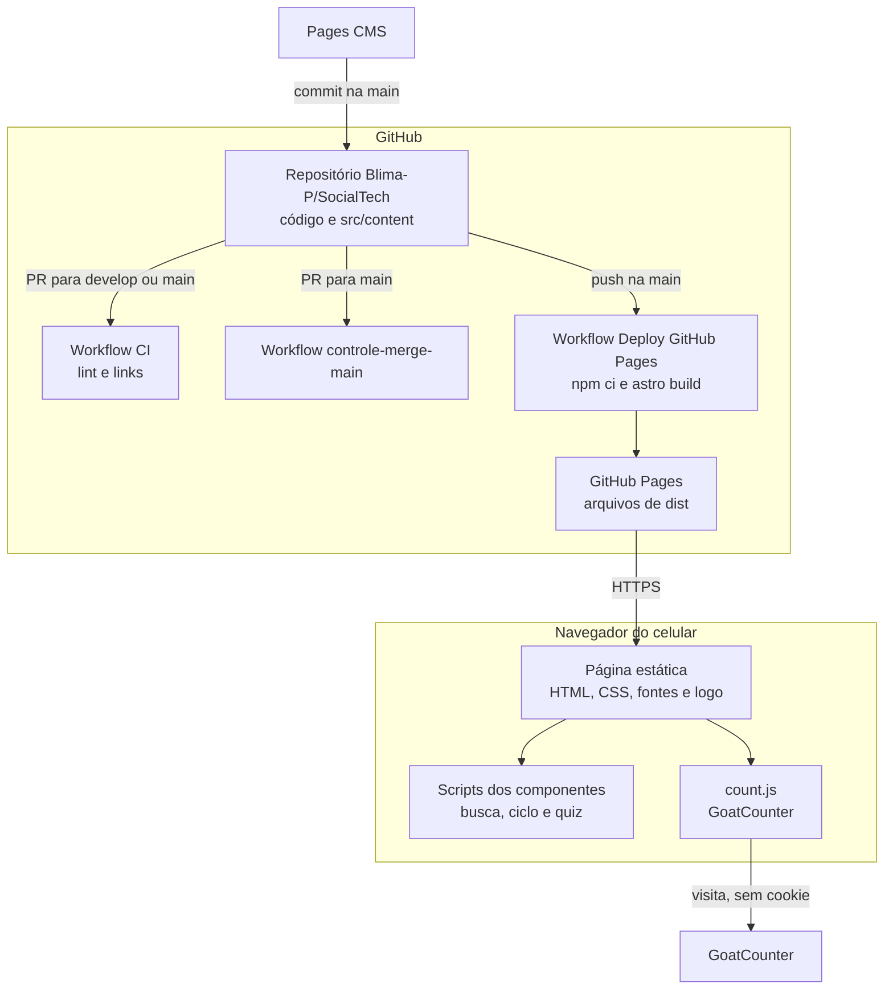
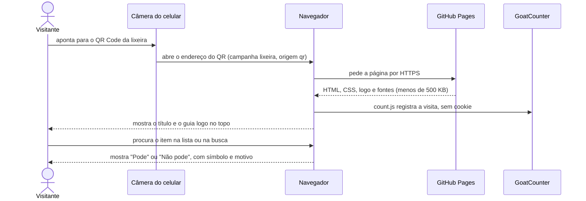
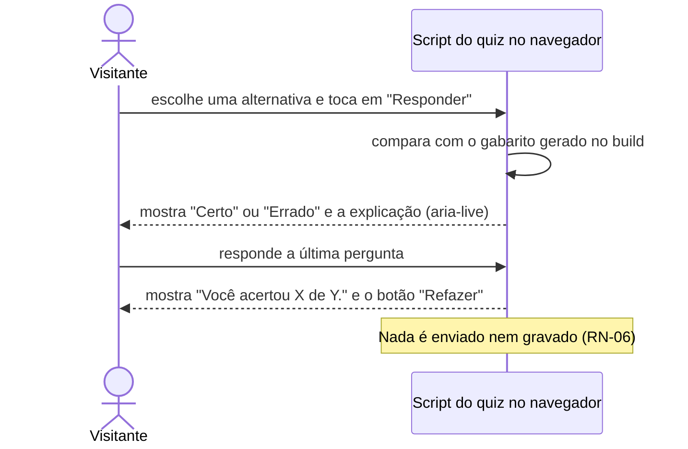
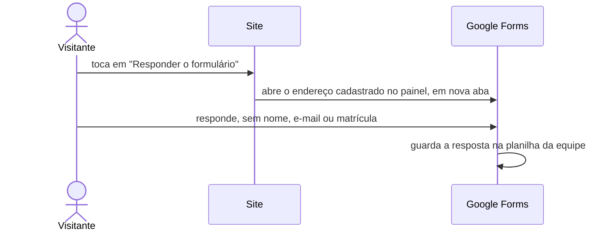
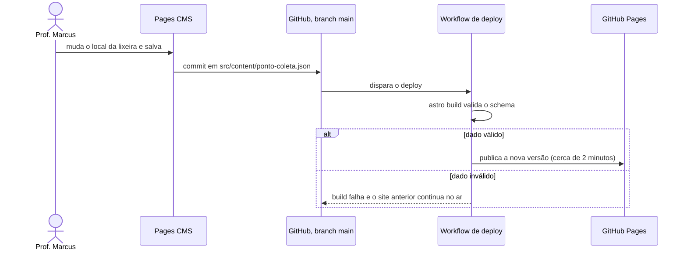
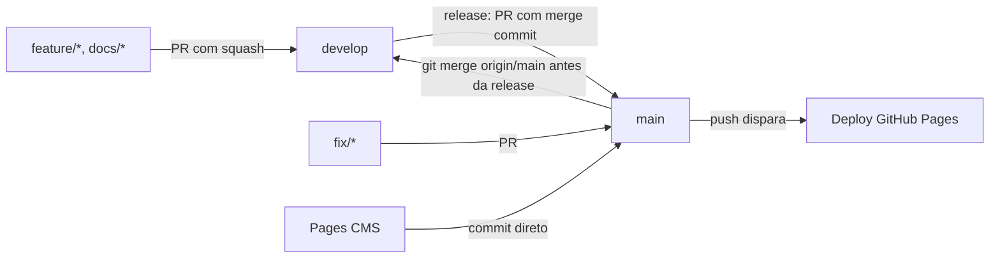

# Arquitetura do SocialTech

> Fase 5 do [`PROMPT-SDD.md`](sdd/PROMPT-SDD.md). Descreve **como** o site atende aos [requisitos](requisitos.md): contexto, containers, componentes, design system, modelo de dados, fluxos, implantação, qualidade e decisões (`ADR-XXX`).
> Formato inspirado no arc42 e no modelo C4, adaptado ao porte do projeto. Marcadores **[CONFIRMADO]**, **[SUPOSIÇÃO]** e **[PENDENTE]** conforme a [constituição](sdd/00-constituicao.md).

| Campo | Valor |
|---|---|
| Versão | 1.0 (26/10/2026) |
| Status | 🚦 Em revisão pela equipe |
| Tarefa | T-16 (issue #37) |
| Base | [Requisitos](requisitos.md), [Plano do MVP](sdd/03-plano-tarefas.md) §1, [Plano da entrega final](sdd/05-plano-entrega-final.md) §1, código da `develop` em 26/10/2026 |

---

## 1. Objetivos e restrições

### 1.1 Objetivos de qualidade (em ordem de prioridade)

| # | Objetivo | Requisitos |
|---|---|---|
| 1 | Quem escaneia o QR decide "pode / não pode" **em até 10 s** num celular com 4G | RF-01, RNF-01, RNF-02, métrica S-05 |
| 2 | Acessível (WCAG 2.1 AA) e usável com uma mão, em 360 px | RNF-03 a RNF-10 |
| 3 | Nenhum dado pessoal coletado | RNF-12, RN-06, RN-07 |
| 4 | O Prof. Marcus edita o conteúdo sozinho, sem quebrar o site | RF-15, RNF-14, RNF-15 |
| 5 | Simples o bastante para estudantes revisarem código gerado por IA | `AGENTS.md` §5 |

### 1.2 Restrições

| Tipo | Restrição | Origem |
|---|---|---|
| Técnica | Site **100% estático** (sem servidor, banco de dados nem API) no GitHub Pages, no subcaminho `/SocialTech/` | ADR-001; `AGENTS.md` §2 e §4.3 |
| Técnica | Nenhuma dependência npm, CDN, fonte externa ou script de terceiro sem aprovação | `AGENTS.md` §4.4 |
| Prazo | MVP em 26/10/2026; entrega final e H2 em **29/10/2026** | Constituição §1 |
| Organização | 4 pessoas com acesso ao GitHub (de 10 estudantes); o editor de conteúdo não programa | Constituição §4; conflito C7 |
| Legal | LGPD (nenhum dado pessoal); uso da marca Enactus autorizado (Q-22); Roboto sob licença SIL OFL 1.1 | `AGENTS.md` §4.7; ADR-004 |
| Custo | Somente serviços gratuitos (GitHub, Pages CMS, GoatCounter, Google Forms) | Constituição, princípio 5 |

## 2. Contexto (C4 nível 1)



| Sistema externo | Papel | Dados trocados |
|---|---|---|
| GitHub (repositório, Actions, Pages) | Guarda o código e o conteúdo, roda o CI, gera e publica o site | Código e arquivos de `src/content/` |
| Pages CMS | Painel do Prof. Marcus; grava commits na `main` (ADR-002) | Conteúdo editado |
| GoatCounter (`socialtech-ucb`) | Conta visitas sem cookies, com campanha e origem (ADR-003) | Endereço da página, referência e campanha; sem identificador pessoal |
| Google Forms | Formulário de avaliação (RF-12), fora do site | Respostas sem nome, e-mail ou matrícula (RN-07) |

## 3. Containers e componentes (C4 níveis 2 e 3)

### 3.1 Containers



| Container | Tecnologia | Responsabilidade |
|---|---|---|
| Página estática | HTML e CSS gerados pelo Astro no build | Todo o conteúdo; funciona sem JavaScript (ADR-008) |
| Scripts dos componentes | TypeScript em `<script>` de cada componente, empacotado pelo Astro | Busca no guia, ciclo passo a passo e quiz; nada é enviado |
| `count.js` | Script do GoatCounter, `async`, só em produção | Registrar a visita (RF-13) |
| Repositório | Git (branches `main`, `develop`, `feature/*`, `fix/*`, `docs/*`) | Código, conteúdo, documentação e materiais do QR |
| CI | GitHub Actions (`ci.yml`) | Prettier, ESLint com regras de acessibilidade, `astro check`, build e lychee |
| Controle de merge | GitHub Actions (`controle-merge-main.yml`) | A `main` só recebe PR de `develop` ou `fix/*` com aprovação de um mantenedor |
| Deploy | GitHub Actions (`deploy-pages.yml`) | Build e publicação a cada push na `main` |

### 3.2 Componentes do site

| Componente | Arquivo | Coleção | Seção (`id`) | JavaScript | Tarefa | Situação |
|---|---|---|---|---|---|---|
| Layout base | `src/layouts/BaseLayout.astro` | — | `<html>`, `<head>` | `count.js` (produção) | T-01, T-08 | ✅ |
| Cabeçalho | `src/components/Cabecalho.astro` | — | `<header>` | Não | T-02, T-11 | ✅ · 🔨 redesign |
| Guia "Pode / Não pode" | `src/components/GuiaPodeNaoPode.astro` | `guia`, `guiaOrientacao` | `guia` | Busca (T-14) | T-05, T-14 | ✅ · 🔨 busca |
| Onde está a lixeira | `src/components/PontoColeta.astro` | `pontoColeta` | `ponto-de-coleta` | Não | T-06, T-11 | ✅ |
| Ciclo do resíduo | `src/components/CicloResiduo.astro` | `ciclo` | `ciclo` | Passo a passo (T-12) | T-03, T-12 | ✅ · 🔨 interativo |
| Números de impacto | `src/components/NumerosImpacto.astro` | `impacto` | `impacto` | Não | T-13 | 🔨 |
| Quiz | `src/components/Quiz.astro` | `quiz` | `quiz` | Sim (T-15) | T-15 | 🔨 |
| Avalie o projeto | `src/components/Avaliacao.astro` | `avaliacao` | `avaliacao` | Não | T-07, T-11 | ✅ |
| Seção do painel | `src/components/Secao.astro` | `secoes` | título `secao-<id>` | Não | Base | ✅ |
| Rodapé | `src/components/Rodape.astro` + `ListaLinks.astro` | `links` | `<footer>` | Não | T-02, T-11 | ✅ |

A página `src/pages/index.astro` só compõe os componentes, na ordem da seção 4.

## 4. Arquitetura da informação

### 4.1 Ordem da página e faixas

Página única (ADR-005) em faixas de largura total (ADR-007). A ordem segue a jornada crítica J1: o guia vem logo depois do cabeçalho.

| Ordem | Seção | `id` | Fundo da faixa | Tarefas | Situação |
|---|---|---|---|---|---|
| 1 | Cabeçalho: barra branca com logo e menu; destaque amarelo com o título e o botão "O que pode ir na lixeira?" | `<header>` | Branco e amarelo | T-02, T-11 | ✅ · 🔨 |
| 2 | Guia "Pode / Não pode", com busca e item não listado | `guia` | Branco | T-05, T-14 | ✅ · 🔨 |
| 3 | Onde está a lixeira agora | `ponto-de-coleta` | Cinza (`--cor-fundo-suave`) | T-06, T-11 | ✅ |
| 4 | Ciclo do resíduo | `ciclo` | Branco | T-03, T-12 | ✅ · 🔨 |
| 5 | Números de impacto | `impacto` | Escuro (`--cor-escura`) | T-13 | 🔨 |
| 6 | Quiz | `quiz` | Branco | T-15 | 🔨 |
| 7 | Avalie o projeto | `avaliacao` | Amarelo (`--cor-destaque`) | T-07, T-11 | ✅ |
| 8 | Seções do painel ("Sobre o projeto" etc.) | `secao-<id>` | Cinza | Base, T-11 | ✅ |
| 9 | Rodapé com contatos e logo | `<footer>` | Escuro | T-02, T-11 | ✅ |

Seções sem conteúdo (impacto vazio, quiz vazio, formulário sem link) **não aparecem** (RN-04).

### 4.2 Wireframe textual no celular (360 px, depois da T-11)

```text
┌──────────────────────────────┐
│▀▀▀▀▀▀ linha amarela ▀▀▀▀▀▀▀▀▀│
│ [logo Enactus]               │  barra branca
├──────────────────────────────┤
│ SocialTech            (h1)   │  destaque amarelo
│ Descarte correto de resíduos │
│ [ O que pode ir na lixeira? ]│  botão escuro → #guia
├──────────────────────────────┤
│ O que pode ir nesta lixeira? │  título visível sem rolar (até ~400 px)
│ [Procure um item.........]   │  busca (só com JavaScript)
│ ✓ Pode                       │
│  ┌ item · motivo ┐           │
│ ✕ Não pode                   │
│  ┌ Frutas cítricas · motivo ┐│
│ Não achou seu item?          │
├──────────────────────────────┤
│ Onde está a lixeira agora    │  faixa cinza
│ Local · como reconhecer      │
│ Atualizado em DD/MM/AAAA     │
├──────────────────────────────┤
│ Do resto de comida à horta   │
│ (1)(2)(3)(4)(5)  Etapa 1 de 5│  passo a passo (só com JavaScript)
│ [Anterior]        [Próxima]  │
├──────────────────────────────┤
│ Por que separar o lixo...?   │  faixa escura
│ 81 milhões de toneladas      │  número amarelo
│ frase · fonte                │
├──────────────────────────────┤
│ Teste o que você aprendeu    │
│ ( ) alternativa  [Responder] │
├──────────────────────────────┤
│ Avalie o projeto             │  faixa amarela
│ [ Responder o formulário ]   │
├──────────────────────────────┤
│ Sobre o projeto              │  faixa cinza
├──────────────────────────────┤
│ Contatos e links · logo      │  rodapé escuro
└──────────────────────────────┘
```

A partir de `48rem`: menu no cabeçalho, recorte diagonal escuro no destaque, guia em 2 colunas e rodapé em 2 colunas. A partir de `64rem`: ciclo em linha e números de impacto em 4 colunas.

## 5. Design system

Os tokens ficam em `src/styles/global.css`. Os componentes usam **só as variáveis**, nunca a cor ou o tamanho direto.

### 5.1 Cores e contraste

Cores da Enactus (`enactus.org.br`, Q-22), mais verde e vermelho escuros para "Pode" e "Não pode". Contraste verificado para WCAG 2.1 AA (RNF-04).

| Token | Valor | Uso | Contraste |
|---|---|---|---|
| `--cor-texto` | `#30333C` | Texto principal | 12,6:1 no branco; 11,3:1 em `#F2F2F2` |
| `--cor-texto-suave` | `#515356` | Datas, legendas | 7,7:1 no branco |
| `--cor-fundo` | `#FFFFFF` | Fundo da página; texto sobre fundo escuro | — |
| `--cor-fundo-suave` | `#F2F2F2` | Faixas cinza e cartões | — |
| `--cor-escura` | `#30333C` | Faixa de impacto e rodapé | Branco: 12,6:1; amarelo: 7,8:1 |
| `--cor-destaque` | `#FFC222` | **Só como fundo** (botões, faixas) com `--cor-texto`, ou como **texto sobre `--cor-escura`** | `#30333C` sobre ele: 7,8:1. Sobre fundo claro: 1,6:1, **proibido** |
| `--cor-pode` | `#1E6B34` | Texto e borda de "Pode" e "Certo" | 6,6:1 no branco; 5,8:1 em `--cor-pode-fundo` |
| `--cor-pode-fundo` | `#E8F5EC` | Fundo do cartão "Pode" | — |
| `--cor-nao-pode` | `#B42318` | Texto e borda de "Não pode" e "Errado" | 6,6:1 no branco; 5,8:1 em `--cor-nao-pode-fundo` |
| `--cor-nao-pode-fundo` | `#FDECEA` | Fundo do cartão "Não pode" | — |

### 5.2 Tipografia

| Item | Valor |
|---|---|
| Fonte | `--fonte-base`: `Roboto, system-ui, -apple-system, "Segoe UI", sans-serif` (ADR-004, ligada pela T-11). Até a T-11, só a pilha do sistema |
| Arquivos | `src/assets/fontes/roboto-latin-400.woff2` e `roboto-latin-700.woff2` (cerca de 44 KB no total), com `font-display: swap`; licença em `src/assets/fontes/LICENSE.txt` |
| Tamanhos | Texto 1rem com `line-height: 1.5`; `h2` 1.375rem; `h3` 1.125rem |
| Largura de leitura | Parágrafos com no máximo `--largura-conteudo` (`40rem`) |

### 5.3 Espaçamento, layout e pontos de quebra

| Token / regra | Valor | Uso |
|---|---|---|
| `--espaco` | `1rem` | Espaçamento base |
| `--raio` | `0.5rem` | Cantos de cartões e botões |
| `--alvo-toque` | `2.75rem` (44 px) | Altura e largura mínimas de botões, links de ação, campos e alternativas (RNF-06) |
| `--largura-conteudo` | `40rem` | Largura máxima de parágrafos |
| `--largura-pagina` | `72rem` | Largura máxima do conteúdo no computador (T-11) |
| `--recuo-lateral` | `max(var(--espaco), calc((100% - var(--largura-pagina)) / 2))` | Recuo das faixas; centraliza sem `<div>` extra (T-11) |
| `--espaco-faixa` | `clamp(2.5rem, 6vw, 4.5rem)` | Espaço vertical de cada faixa (T-11) |
| Celular (base) | até `47.99rem` | Uma coluna (mobile-first) |
| `@media (min-width: 48rem)` | 768 px | Menu no cabeçalho; grades de 2 colunas |
| `@media (min-width: 64rem)` | 1024 px | Ciclo em linha; impacto em 4 colunas |

### 5.4 Foco, movimento e semântica

- Foco: `:focus-visible` com contorno de 3 px em `currentcolor` e afastamento de 2 px, visível em fundos claro, amarelo e escuro.
- Movimento: com `prefers-reduced-motion: reduce`, animações e transições são zeradas; rolagem suave só com `no-preference` (RNF-09).
- Semântica: um único `<h1>` no cabeçalho; cada seção é `<section id="…" aria-labelledby="…">` com `<h2>`; listas com `<ul>`/`<ol>`; botões com `<button>`; links externos que abrem nova aba avisam "(abre em nova aba)" para leitor de tela.

### 5.5 Componentes de interface

| Componente | Regras |
|---|---|
| Botão de ação | Fundo `--cor-escura` com texto branco, ou fundo `--cor-destaque` com texto `--cor-texto`; altura ≥ `--alvo-toque`; foco visível |
| Cartão "Pode" / "Não pode" | Fundo `--cor-pode-fundo` ou `--cor-nao-pode-fundo`, borda e título na cor forte; grupo com título "✓ Pode" ou "✕ Não pode" (símbolo com `aria-hidden`) |
| Campo de busca | `<label>` visível "Procure um item" + `<input type="search">`; contagem de resultados em `aria-live="polite"` |
| Etapa do ciclo | Número em círculo (`aria-hidden`), nome e frase; seta entre etapas (decorativa) |
| Controles do ciclo | Botões numerados com `aria-label="Etapa X: <nome>"` e `aria-current="step"`; "Anterior" e "Próxima" desabilitados nas pontas |
| Número de impacto | Número grande em `--cor-destaque` sobre `--cor-escura`; descrição e fonte em `--cor-fundo`; sem animação |
| Pergunta do quiz | `<fieldset>` com `<legend>`; alternativas em `<input type="radio">` + `<label>`; resultado "✓ Certo" / "✕ Errado" em `aria-live` |
| Título de seção | `<h2>` com traço amarelo embaixo (escuro na faixa amarela e no rodapé) (T-11) |

## 6. Modelo de dados do conteúdo

Todo o conteúdo fica em `src/content/` como Content Collections do Astro (ADR-006). Os schemas `zod` estão em [`src/content.config.ts`](../src/content.config.ts) (fonte da verdade) e os campos do painel em [`.pages.yml`](../.pages.yml). Os dois mudam **no mesmo PR** (`AGENTS.md` §4.9). O passo a passo para o professor está no [guia de edição](guia-edicao-conteudo.md).

Regras comuns:

- **Listas** (`guia`, `ciclo`, `links`, `impacto`, `quiz`): o `id` de cada item é a posição na lista, para manter a ordem do painel.
- **Objetos únicos** (`pontoColeta`, `avaliacao`, `guiaOrientacao`): o loader devolve um único item com `id` fixo, lido com `getEntry("<coleção>", "<id>")`.
- **Campos opcionais**: `""` e `null` salvos pelo painel viram "sem valor" (`vazioParaUndefined`).
- **Dado inválido** faz o build falhar, e o site continua na versão anterior (RNF-15).

| Coleção | Arquivo | Formato | Campos (obrigatório **negrito**) | Lido por | Tarefa | Situação |
|---|---|---|---|---|---|---|
| `secoes` | `src/content/secoes/*.md` | Markdown com frontmatter | **`titulo`**, **`ordem`** (inteiro), `publicada` (padrão `true`), `imagem`, `descricaoImagem` (**obrigatória se houver imagem**); corpo em Markdown | `Secao.astro` | Base | ✅ |
| `links` | `src/content/links.json` | Lista | **`nome`**, **`tipo`** (`site`, `email` ou `whatsapp`), **`endereco`** (URL http(s), e-mail ou 12 a 13 dígitos, conforme o tipo) | `ListaLinks.astro` | Base | ✅ |
| `guia` | `src/content/guia.json` | Lista | **`nome`**, **`classificacao`** (`pode` ou `nao-pode`), **`motivo`** | `GuiaPodeNaoPode.astro` | T-05 | ✅ |
| `pontoColeta` | `src/content/ponto-coleta.json` | Objeto (`id` `atual`) | **`local`**, **`comoReconhecer`**, **`atualizadoEm`** (data `AAAA-MM-DD`) | `PontoColeta.astro` | T-06 | ✅ |
| `ciclo` | `src/content/ciclo.json` | Lista ordenada | **`nome`**, `descricao` | `CicloResiduo.astro` | T-03 | ✅ |
| `avaliacao` | `src/content/avaliacao.json` | Objeto (`id` `formulario`) | **`texto`**, `endereco` (só `https://`) | `Avaliacao.astro` | T-07 | ✅ |
| `impacto` | `src/content/impacto.json` | Lista | **`numero`**, **`descricao`**, **`fonte`** (todos texto) | `NumerosImpacto.astro` | T-13 | 🔨 |
| `guiaOrientacao` | `src/content/guia-orientacao.json` | Objeto (`id` `atual`) | `naoListado` | `GuiaPodeNaoPode.astro` | T-14 | 🔨 |
| `quiz` | `src/content/quiz.json` | Lista | **`pergunta`**, **`alternativas`** (2 a 4 textos), **`correta`** (número da alternativa certa, a partir de 1, que precisa existir), **`explicacao`** | `Quiz.astro` | T-15 | 🔨 |

Os schemas das três coleções novas estão no [plano da entrega final §1.3](sdd/05-plano-entrega-final.md#13-contrato-de-dados-novas-coleções), testados com `npm run verify` em 26/10/2026.

**Exemplo fictício** (só para mostrar o formato; **não** é conteúdo validado e não deve ser publicado):

```json
[
  {
    "pergunta": "EXEMPLO: texto da pergunta?",
    "alternativas": ["EXEMPLO: alternativa 1", "EXEMPLO: alternativa 2"],
    "correta": 1,
    "explicacao": "EXEMPLO: por que a alternativa 1 está certa."
  }
]
```

## 7. Estrutura de pastas e convenções

```text
SocialTech/
├── .github/
│   ├── CODEOWNERS                  # @Blima-P e @alber-th aprovam PRs
│   ├── ISSUE_TEMPLATE/             # templates "Tarefa" e "Bug"
│   ├── pull_request_template.md
│   └── workflows/                  # ci.yml, deploy-pages.yml, controle-merge-main.yml
├── docs/
│   ├── requisitos.md               # Fase 4
│   ├── arquitetura.md              # Fase 5 (este documento)
│   ├── guia-edicao-conteudo.md     # passo a passo do painel para o professor
│   ├── equipe/                     # guias para a IA de cada integrante
│   ├── materiais/                  # qr-lixeira.png e adesivo-lixeira.pdf
│   └── sdd/                        # constituição, especificação, clarificações, planos e revisão
├── src/
│   ├── assets/
│   │   ├── fontes/                 # Roboto WOFF2 + licença (ADR-004)
│   │   └── marca/                  # logos da Enactus Brasil
│   ├── components/                 # um componente .astro por seção (PascalCase)
│   ├── content/                    # conteúdo do painel (JSON e secoes/*.md)
│   ├── layouts/BaseLayout.astro    # <html>, <head>, GoatCounter
│   ├── pages/index.astro           # página única: só compõe os componentes
│   ├── styles/global.css           # tokens e estilos globais
│   └── content.config.ts           # schemas zod das coleções
├── .pages.yml                      # campos do painel Pages CMS
├── astro.config.mjs                # site + base "/SocialTech/"
└── AGENTS.md                       # regras para agentes de IA
```

| Item | Convenção |
|---|---|
| Componentes | PascalCase, um por responsabilidade (`NumerosImpacto.astro`) |
| Coleções | camelCase no código (`pontoColeta`) e kebab-case no arquivo (`ponto-coleta.json`) |
| `id` de seção | kebab-case em português (`ponto-de-coleta`); o `<h2>` tem `id="titulo-<nome curto>"` (ex.: `titulo-ponto`), usado no `aria-labelledby` |
| Links internos | Sempre com `import.meta.env.BASE_URL` (o site fica em `/SocialTech/`) |
| Estilos | `<style>` do componente (escopo automático); tokens em `global.css`; sem `!important` fora do bloco de movimento reduzido |
| Branches | `feature/<nº da issue>-<descrição>`, `fix/<descrição>`, `docs/<descrição>` |
| Commits | Conventional Commits em português (`feat(guia): …`, `docs(sdd): …`), sem trailer de coautoria de IA |

## 8. Fluxos dinâmicos

### 8.1 Escanear o QR Code e consultar o guia (jornada J1)



### 8.2 Responder o quiz (jornada J3)



### 8.3 Responder o formulário de avaliação (jornada J4)



### 8.4 Editar o conteúdo pelo painel (jornada J7)



## 9. Implantação

### 9.1 Branches e fluxo



| Regra | Onde é garantida |
|---|---|
| PR para `develop`: 1 aprovação de code owner (`@Blima-P` ou `@alber-th`), aprovação depois do último push, sem force push | Proteção da branch `develop`; `.github/CODEOWNERS` |
| PR para `main`: só de `develop` ou `fix/*`, com aprovação de um mantenedor | Workflow `controle-merge-main.yml` |
| CI verde (`lint` e `links`) em todo PR | `ci.yml` |
| Release `develop` → `main` com **merge commit** (`gh pr merge --merge`), depois de `git merge origin/main` na `develop` | Plano da entrega final, T-17 |
| Edições do painel vão direto para a `main` (bypass do app no ruleset) | ADR-002 |

### 9.2 Publicação

- **URL:** `https://blima-p.github.io/SocialTech/` (`site` e `base: "/SocialTech/"` em `astro.config.mjs`).
- **Gatilho:** push na `main` (merge de release, `fix/*` ou edição do painel) ou execução manual do workflow.
- **Passos:** `npm ci` → `npm run build` (gera `dist/`) → upload do artefato → `deploy-pages`. Tempo típico: cerca de 2 minutos.
- **Contagem de acessos:** o script do GoatCounter só entra no build de produção (`import.meta.env.PROD`).

### 9.3 QR Code

| Item | Definição |
|---|---|
| Endereço | `https://blima-p.github.io/SocialTech/?campaign=lixeira&ref=qr` (cartazes: `ref=cartaz`) |
| Tipo | **Estático**: o endereço está no próprio desenho; sem encurtador, redirecionamento ou "QR dinâmico" |
| Geração | Script Python avulso com a biblioteca `qrcode` (fora do site e do `package.json`): correção de erro M, margem de 4 módulos, preto sobre branco |
| Versionamento | `docs/materiais/qr-lixeira.png` e `docs/materiais/adesivo-lixeira.pdf` no repositório (T-04) |
| Teste | Escanear o **papel impresso** em 2 celulares antes de divulgar (constituição §7; RH-01) |

### 9.4 Reversão

| Situação | O que fazer |
|---|---|
| Build falhou (código ou dado inválido) | Nada vai ao ar; o site anterior continua publicado. Corrigir o dado pelo painel ou abrir `fix/*` |
| Release publicou um erro | Criar `fix/<descrição>` a partir da `main`, rodar `git revert` do commit da release (no merge commit, `git revert -m 1 <commit>`), abrir PR para `main` e mesclar; depois, `git merge origin/main` na `develop` |
| O professor publicou um texto errado | Ele corrige pelo painel (novo commit); se precisar, um mantenedor reverte o commit numa `fix/*` |
| Endereço do site mudar | O QR estático deixa de funcionar: é preciso gerar e **reimprimir** o adesivo (dívida DT-04) |

## 10. Qualidade

### 10.1 Estratégia de testes

| Verificação | Ferramenta | Quando | Requisitos |
|---|---|---|---|
| Formatação | Prettier (`npm run format:check`) | Local e CI em todo PR | RNF-14 |
| Lint e acessibilidade estática | ESLint com `eslint-plugin-jsx-a11y-x`; bloqueio de `set:html` | Local e CI | RNF-07, RNF-13 |
| Tipos e templates | `astro check` | Local e CI | RNF-14 |
| Schema do conteúdo | `astro build` (zod) | Local, CI e deploy | RF-15, RNF-15 |
| Links quebrados | lychee (`*.md` e `src/**/*.astro`) | CI em todo PR | T-16 |
| Layout em 360 px e 1366 px | Modo responsivo do navegador + capturas no PR | Toda tarefa visual (DoD) | RNF-05 |
| Teclado, foco e leitor de tela | Tab/Enter/Espaço; TalkBack ou VoiceOver | Tarefas interativas e homologação | RNF-07 |
| Sem JavaScript | Desativar o JavaScript no navegador | T-12, T-14, T-15 e homologação | RNF-10 |
| Privacidade | Aba Rede e aba Aplicação (Cookies, Local Storage) | T-08, T-14, T-15 e homologação | RNF-12 |
| Desempenho e acessibilidade | Lighthouse em modo celular, na página publicada | H2 | RNF-01 a RNF-03 |
| Celulares reais | 2 celulares (Android e iPhone, se possível), 4G | Antes de cada release e nas homologações | RNF-11 |

Não há testes automatizados de comportamento (busca, ciclo, quiz): eles são verificados à mão pelos critérios de aceite (dívida DT-01).

### 10.2 Roteiro de homologação

Roteiro previsto na [constituição §8](sdd/00-constituicao.md#8-homologação). Vale para a H1, a H2 e o teste da equipe antes de cada release depois do QR impresso. Use o **site publicado**, em **2 celulares reais com 4G** (Wi-Fi desligado) e, na H2, num computador de 1366 px.

| Passo | O que fazer | Resultado esperado | Requisitos | H1 | H2 |
|---|---|---|---|---|---|
| RH-01 | Escanear o QR **impresso** na lixeira a 1 m de distância, nos 2 celulares | Abre o site com `?campaign=lixeira&ref=qr` na barra de endereço | RF-14 | H1-1, H1-7 | H2-1 |
| RH-02 | Abrir o painel do GoatCounter | O acesso do RH-01 aparece com a campanha `lixeira` | RF-13 | H1-6 | H2-7 |
| RH-03 | Teste de 10 s: 5 pessoas, cada uma com o nome de um item da lista; cronometrar da abertura do QR até dizer "pode" ou "não pode" | Pelo menos 4 de 5 decidem em até 10 s (S-05) | RF-01 | H1-1 | — |
| RH-04 | Buscar "cítrica", "CITRICA" e "citrica"; buscar um item fora da lista | Os três acham "Frutas cítricas"; o item fora da lista mostra a orientação (ou o aviso de pendência) | RF-02, RF-03 | — | H2-2 |
| RH-05 | Conferir as etapas do ciclo; navegar pelo toque e, no computador, só pelo teclado | Etapas e frases corretas; navegação funciona | RF-04, RF-05 | H1-3 | H2-3 |
| RH-06 | Conferir o local da lixeira; o Prof. Marcus muda o local pelo painel | Local correto; a mudança aparece em até 5 minutos | RF-06, RF-15 | H1-4 | — |
| RH-07 | O Prof. Marcus confere os números de impacto e as fontes | Números e fontes corretos | RF-10 | — | H2-4 |
| RH-08 | Responder o quiz inteiro com a aba Rede aberta (computador) e tocar em "Refazer" | Gabarito e explicações validados; nenhuma requisição | RF-11, RN-06 | — | H2-5 |
| RH-09 | Tocar em "Responder o formulário" | Abre o formulário certo em nova aba | RF-12 | H1-5 | — |
| RH-10 | O Prof. Marcus edita pelo painel um número de impacto e uma pergunta do quiz (em rascunho), sem ajuda | Consegue sozinho | RF-15 | — | H2-8 |
| RH-11 | Em 360 px e 1366 px: rolar a página toda, navegar com Tab e repetir com o JavaScript desativado | Sem rolagem horizontal; foco visível; conteúdo legível sem JavaScript | RNF-05, RNF-07, RNF-10 | H1-7 | H2-1 |
| RH-12 | Rodar o Lighthouse (modo celular) e conferir os cookies | Acessibilidade ≥ 90; peso < 500 KB; nenhum cookie | RNF-01 a RNF-03, RNF-12 | — | H2-6 |

**Validação de conteúdo:** a Enactus confere os itens do guia e os nomes do ciclo (H1-2, H1-3, H2-3); o Prof. Marcus confere os textos.

**Registro:** na descrição do PR de release `develop` → `main`, anotar data, aprovadores, celulares usados (modelo e sistema), resultado de cada passo e problemas encontrados. Esse registro é evidência para o relatório (roteiro, item 2.9; E-10).

## 11. Decisões de arquitetura (ADR)

| ADR | Decisão | Status | Data |
|---|---|---|---|
| [ADR-001](#adr-001--stack-astro--typescript--css-puro-site-estático) | Astro + TypeScript + CSS puro, site estático | Aceito | 15/10/2026 |
| [ADR-002](#adr-002--edição-de-conteúdo-pelo-pages-cms) | Edição de conteúdo pelo Pages CMS | Aceito | 16/10/2026 |
| [ADR-003](#adr-003--contagem-de-acessos-com-goatcounter) | Contagem de acessos com GoatCounter | Aceito | 22/10/2026 |
| [ADR-004](#adr-004--fonte-roboto-auto-hospedada-revisado) | Fonte Roboto auto-hospedada (revisado) | Aceito (revisão de 26/10) | 22/10 e 26/10/2026 |
| [ADR-005](#adr-005--página-única) | Página única | Aceito | 22/10/2026 |
| [ADR-006](#adr-006--conteúdo-em-coleções-json-com-schema) | Conteúdo em coleções JSON com schema | Aceito | 22/10/2026 |
| [ADR-007](#adr-007--layout-em-faixas-de-largura-total) | Layout em faixas de largura total | Aceito | 26/10/2026 |
| [ADR-008](#adr-008--interatividade-com-aprimoramento-progressivo) | Interatividade com aprimoramento progressivo | Aceito | 26/10/2026 |

### ADR-001 · Stack: Astro + TypeScript + CSS puro, site estático

- **Status:** Aceito pela equipe em 15/10/2026 [CONFIRMADO].
- **Contexto:** página acessada pelo celular, no 4G, ao lado da lixeira; equipe de estudantes revisando código gerado por IA; prazo curto; hospedagem gratuita no GitHub Pages.
- **Opções:**

| Opção | Descrição | Avaliação |
|---|---|---|
| A | HTML/CSS/JS puro, sem build | Simples, mas menos manutenível conforme cresce; sem tipagem nem validação de conteúdo |
| B | Gerador estático em Python (Jinja2, MkDocs, Pelican) | MkDocs é voltado a documentação; ecossistema de componentes web menor |
| C | Aplicação Python (Streamlit, Dash, Flask) | Exige servidor e outra hospedagem; lento para abrir no 4G; maior risco de prazo |
| **D (escolhida)** | **Astro + TypeScript** | Componentes parecidos com HTML; zero JavaScript por padrão; conteúdo validado por schema; TypeScript ajuda a revisar código de IA; continua estático no GitHub Pages |

- **Decisão:** Astro + TypeScript (`strict`) + CSS puro, saída estática publicada no GitHub Pages por GitHub Actions. Python só como ferramenta auxiliar fora do site (QR Code, análise do formulário).
- **Consequências:** há etapa de build, `package.json` e `package-lock.json`; Node.js 22.22+ para desenvolver; CI com Prettier, ESLint, `astro check` e build. O roteiro (Fase 3) cita HTML/CSS/JS, o que continua verdadeiro no resultado final (o Astro gera HTML, CSS e JS); isso deve ser mencionado no relatório.
- **Requisitos:** RNF-01, RNF-02, RNF-10, RNF-14, RNF-16.

### ADR-002 · Edição de conteúdo pelo Pages CMS

- **Status:** Aceito em 16/10/2026 [CONFIRMADO].
- **Contexto:** o Prof. Marcus quer editar o site sozinho, pela tela, sem mexer em código, e ver a mudança publicada sem depender da equipe.
- **Opções:** editar Markdown no próprio GitHub (exige conta e familiaridade); Decap ou Sveltia CMS (exigem servidor de autenticação OAuth); planilha Google lida no build (sem validação nem imagens); **Pages CMS (escolhida)**.
- **Decisão:** painel Pages CMS (open source, gratuito), configurado em `.pages.yml`. O professor entra por convite de e-mail, sem conta no GitHub. Cada "Salvar" vira um commit **direto na `main`** (ruleset com bypass para o app) e o site é republicado em cerca de 2 minutos.
- **Consequências:** `src/content.config.ts` e `.pages.yml` mudam juntos; dado inválido faz o build falhar e o site continua na versão anterior; antes de cada release, a `develop` recebe as edições da `main`; edições do professor não passam por revisão (aceito pela equipe); mudanças em regras de descarte são combinadas antes com a Enactus (RN-08).
- **Requisitos:** RF-06, RF-07, RF-08, RF-15, RNF-14, RNF-15.

### ADR-003 · Contagem de acessos com GoatCounter

- **Status:** Aceito em 22/10/2026 (Q-10 e Q-11) [CONFIRMADO]. Implementado na T-08.
- **Contexto:** o roteiro exige medir acessos via QR Code (meta S-01: ≥ 150) com o mecanismo testado antes da divulgação, sem dados pessoais e sem cookies de rastreamento (`AGENTS.md` §4.7).
- **Opções** (a Q-10 registrou só a escolha; as alternativas foram reconstituídas neste documento) [SUPOSIÇÃO]:

| Opção | Avaliação |
|---|---|
| Google Analytics | Usa cookies e identificadores; conflita com `AGENTS.md` §4.7 |
| Contador próprio | Exige servidor e banco de dados; conflita com ADR-001 |
| **GoatCounter (escolhida)** | Gratuito para uso não comercial, sem cookies, sem dado pessoal; separa campanha e origem pela URL; um script `async` pequeno |

- **Decisão:** script `count.js` do GoatCounter no `<head>` do `BaseLayout.astro`, com `is:inline` e `async`, **só no build de produção**, para o site `socialtech-ucb`. Os acessos do QR são separados pelos parâmetros `?campaign=lixeira&ref=qr` (cartazes: `ref=cartaz`).
- **Consequências:** é um script de terceiro aprovado pela equipe (`AGENTS.md` §4.4); o código do site não é segredo; bloqueadores de anúncio podem impedir a contagem, então o número é um **mínimo** (R-09); o quiz e a busca não mandam eventos (RN-06); a evidência para o relatório são prints do painel do GoatCounter (E-10).
- **Requisitos:** RF-13, RNF-12, RNF-16.

### ADR-004 · Fonte: Roboto auto-hospedada (revisado)

- **Status:** Aceito. Versão original em 22/10/2026 (fontes do sistema no MVP, Q-16); **revisado em 26/10/2026**, aprovado pelo Pedro [CONFIRMADO].
- **Contexto:** a identidade da Enactus usa Roboto (C-12, Q-22), mas `AGENTS.md` §4.4 proíbe fontes externas sem aprovação, e o site precisa abrir cedo no 4G (RNF-01, RNF-02).
- **Opções:**

| Opção | Avaliação |
|---|---|
| Google Fonts (CDN) | Requisição a terceiro, com rastreamento; proibido pelo `AGENTS.md` §4.4 |
| Pacote npm de fonte | Dependência nova sem necessidade |
| Fontes do sistema | 0 KB; usada no MVP, mas não segue a identidade da Enactus |
| **Roboto auto-hospedada (escolhida na revisão)** | WOFF2 nos pesos 400 e 700, só caracteres latinos, cerca de 44 KB no total, servida pelo próprio site |

- **Decisão:** arquivos em `src/assets/fontes/` (com a licença SIL OFL 1.1), carregados com `@font-face` e `font-display: swap`; a pilha do sistema continua como reserva em `--fonte-base`. Os arquivos entraram na T-10 e o CSS que os usa entra na T-11.
- **Consequências:** cerca de 44 KB a mais na primeira visita (bem abaixo do limite de 500 KB); nenhuma requisição a outro domínio; o texto aparece logo com a fonte do sistema e troca quando a Roboto carrega.
- **Requisitos:** RF-09, RNF-01, RNF-12, RNF-16.

### ADR-005 · Página única

- **Status:** Aceito em 22/10/2026 (premissa 2 da especificação) [CONFIRMADO].
- **Contexto:** a jornada crítica J1 (decidir em até 10 s) começa no instante em que o QR abre o site; cada página a mais é um carregamento a mais no 4G.
- **Opções** (reconstituídas) [SUPOSIÇÃO]: várias páginas (`guia/`, `ciclo/`, `quiz/`), com um menu; **uma página com seções (escolhida)**.
- **Decisão:** `src/pages/index.astro` com todas as seções, na ordem da seção 4, e o guia logo depois do cabeçalho. No computador, o menu do cabeçalho leva às seções por âncora (`#guia`, `#ponto-de-coleta`, `#ciclo`).
- **Consequências:** uma só requisição de página; os `id` das seções são estáveis e servem de âncora; a página cresce a cada seção, então o peso é conferido na H2 (RNF-01); seções sem conteúdo não aparecem (RN-04).
- **Requisitos:** RF-01, RF-09, RNF-01, métrica S-05.

### ADR-006 · Conteúdo em coleções JSON com schema

- **Status:** Aceito em 22/10/2026 (plano do MVP) [CONFIRMADO].
- **Contexto:** itens do guia, etapas, local, link do formulário, números e perguntas precisam ser editáveis pelo painel (ADR-002) e validados, sem misturar conteúdo e lógica (constituição, princípio 8).
- **Opções** (reconstituídas) [SUPOSIÇÃO]: dados escritos no código (o professor não consegue editar); um arquivo Markdown por item (muitos arquivos para listas curtas); **um arquivo JSON por coleção, com schema `zod` e campos no `.pages.yml` (escolhida)**.
- **Decisão:** cada coleção é um JSON em `src/content/`, lido com o loader `file()` do Astro; listas usam a posição como `id`, objetos únicos usam um `id` fixo. As seções de texto livre continuam em Markdown (`secoes/*.md`).
- **Consequências:** o build falha se faltar campo obrigatório (o site anterior continua no ar); campos opcionais vazios salvos pelo painel são tratados como "sem valor"; para tarefas em paralelo, a base deixa **marcadores** `T-XX` nos arquivos compartilhados (`content.config.ts`, `.pages.yml`, `index.astro`, guia de edição).
- **Requisitos:** RF-15, RNF-14, RN-04.

### ADR-007 · Layout em faixas de largura total

- **Status:** Aceito em 26/10/2026 (plano da entrega final) [CONFIRMADO]. Implementação na T-11.
- **Contexto:** no MVP, todo o conteúdo ficava numa coluna de `40rem`, também no computador, longe do estilo de `enactus.org.br` (C-12).
- **Opções** (reconstituídas) [SUPOSIÇÃO]: manter a coluna única de `40rem`; **faixas de largura total com conteúdo centralizado em até `72rem` (escolhida)**.
- **Decisão:** cada seção do `<main>` é uma faixa com fundo próprio (seção 4.1), com recuo lateral `--recuo-lateral`; no celular, uma coluna; a partir de `48rem`, menu e grades de 2 colunas ou mais. Parágrafos continuam limitados a `40rem`.
- **Consequências:** o `main` deixa de ter largura máxima; tokens novos (`--largura-pagina`, `--recuo-lateral`, `--espaco-faixa`); a T-11 mexe no `<style>` de vários componentes, por isso a T-12 só começa depois dela.
- **Requisitos:** RF-09, RNF-05.

### ADR-008 · Interatividade com aprimoramento progressivo

- **Status:** Aceito em 26/10/2026 (plano da entrega final) [CONFIRMADO]. Implementação nas T-12, T-14 e T-15.
- **Contexto:** busca, ciclo interativo e quiz precisam de JavaScript, mas o site deve funcionar em celular fraco e com JavaScript bloqueado, sem framework de UI (`AGENTS.md` §4.3).
- **Opções** (reconstituídas) [SUPOSIÇÃO]: framework de UI (Preact ou Svelte com `client:*`), que exige aprovação e acrescenta peso; JavaScript puro que monta o conteúdo no navegador (sem JavaScript, nada aparece); **HTML completo gerado no build + `<script>` do próprio componente que só acrescenta os controles (escolhida)**.
- **Decisão:** o HTML traz todo o conteúdo; os controles interativos vêm com `hidden` e o script os mostra; os dados que o script precisa (ex.: gabarito do quiz) vêm de atributos `data-*` gerados no build; o script usa `textContent` e `createElement`, nunca `innerHTML`.
- **Consequências:** sem JavaScript, o guia aparece completo, o ciclo mostra todas as etapas e o quiz mostra as perguntas com um aviso `<noscript>`; nenhuma dependência nova; o quiz não mede nada (RN-06, Q-12).
- **Requisitos:** RF-02, RF-05, RF-11, RNF-07, RNF-10, RNF-12, RNF-16.

## 12. Riscos técnicos e dívidas aceitas

| ID | Dívida ou risco | Consequência | Tratamento |
|---|---|---|---|
| DT-01 | Sem testes automatizados de comportamento (busca, ciclo, quiz) | Regressões só aparecem no teste manual | Aceito pelo prazo; critérios de aceite e roteiro de homologação cobrem os casos |
| DT-02 | Edições do painel vão direto para a `main`, sem revisão (ADR-002) | A `develop` fica atrás da `main` | `git merge origin/main` na `develop` antes e depois de cada release |
| DT-03 | Lighthouse não roda no CI | Peso ou acessibilidade podem piorar sem aviso | Medição manual na H2 (RH-12) |
| DT-04 | O QR estático aponta para `blima-p.github.io/SocialTech` | Renomear o repositório ou trocar de domínio quebra o QR impresso | Não renomear o repositório; se mudar, reimprimir o adesivo |
| DT-05 | Dependência de serviços gratuitos (GoatCounter, Pages CMS) | Se saírem do ar, a contagem ou a edição param; o site continua no ar | Aceito; o site não depende deles para funcionar |
| DT-06 | `.pages.yml` e `content.config.ts` podem divergir se só um for alterado | O painel salva um dado que o build recusa | Regra do `AGENTS.md` §4.9 e revisão de PR |
| R-08 | A T-12 depende do merge da T-11 | Ciclo interativo pode ficar fora da release | Se atrasar, a release sai com o ciclo simples (RF-04) |
| R-09 | Bloqueadores de anúncio impedem a contagem | S-01 subcontado | Registrar a limitação no relatório |
