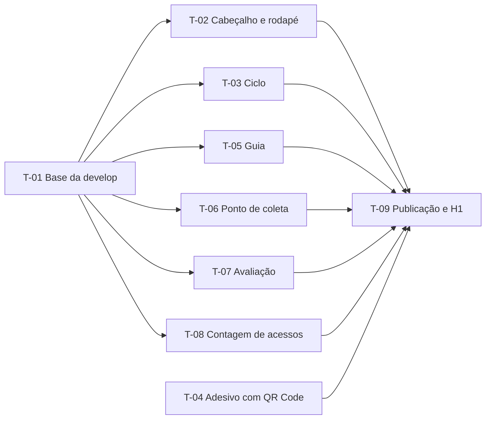

# Plano de tarefas do MVP (Fase 6, atalho "MVP primeiro")

| Campo | Valor |
|---|---|
| Projeto | SocialTech (UCB + Projeto Enactus) |
| Fase SDD | 6 (Plano de tarefas), somente o **MVP** |
| Versão | 1.2 (26/10/2026): H1 remarcada para 26/10 às 20h |
| Status | 🚦 Em revisão pela equipe |
| Base | [Constituição](00-constituicao.md), [Especificação](01-especificacao.md), [Clarificações](02-clarificacoes.md) |

## 0. Como usar este plano

- Cada tarefa `T-XX` vira **uma issue** com o template **Tarefa** e **um PR** para `develop`.
- O responsável cria a branch a partir de `develop` (`feature/<nº da issue>-<descrição>`), cola o **prompt de implementação** no agente de IA, revisa o código gerado, roda `npm run verify` e abre o PR com `Closes #<nº>`.
- O agente de IA **não faz commit nem push**: quem faz é a pessoa responsável, depois de revisar.
- Prazos em horário de Brasília. A Homologação 1 (H1) é em **26/10/2026 (segunda) às 20h** (Q-14). Ela estava marcada para 23/10 às 23h, foi adiada para 25/10 às 20h porque as tarefas da equipe não ficaram prontas e depois para 26/10, porque a T-03 ainda estava em revisão.

### 0.1 Exceção aprovada à Definição de Preparado

A equipe escolheu, em 22/10/2026, o atalho **"MVP primeiro"**: o plano do MVP foi feito antes dos requisitos (Fase 4) e da arquitetura (Fase 5) para cumprir o prazo de 23/10. Por isso, **as tarefas do MVP apontam para capacidades `C-XX` da especificação** (seção 4), e não para `RF`/`RNF`. As Fases 4, 5 e 7 continuam depois do MVP e vão ligar cada `C-XX` aos `RF`/`RNF` correspondentes. Os demais itens da Definição de Preparado (constituição §5) continuam valendo.

## 1. Decisões técnicas antecipadas do MVP

Estas decisões serão registradas como ADR em `docs/arquitetura.md` na Fase 5. Até lá, valem como estão aqui.

| ID | Decisão | Motivo | Ligada a |
|---|---|---|---|
| ADR-003 | Contagem de acessos com **GoatCounter** (script `count.js`, sem cookies, só em produção) | Gratuito para uso não comercial, sem dado pessoal, separa a origem pela URL (Q-10, Q-11) | C-08, S-01 |
| ADR-004 | **Fontes do sistema** no MVP (sem download de fonte) | 0 KB, abre mais cedo no 4G; `AGENTS.md` §4.4 (Q-16) | C-12 |
| ADR-005 | **Página única**, com a ordem de seções da seção 1.2 | A jornada crítica J1 (decidir em ≤ 10 s) começa no topo da página | J1, S-05 |
| ADR-006 | Conteúdo novo em arquivos JSON de `src/content/`, com schema `zod` e campos no `.pages.yml` | Constituição, princípio 8; ADR-002 | C-11 |

### 1.1 Tokens de design (contraste já verificado, WCAG 2.1 AA)

Cores da Enactus (`enactus.org.br`, Q-22), mais verde e vermelho escuros para "Pode" e "Não pode". A T-01 grava estes tokens em `src/styles/global.css`; todas as tarefas usam **só as variáveis**, nunca a cor direto.

| Token | Valor | Uso | Contraste |
|---|---|---|---|
| `--cor-texto` | `#30333C` | Texto principal | 12,6:1 no branco; 11,3:1 em `#F2F2F2` |
| `--cor-texto-suave` | `#515356` | Texto secundário (datas, legendas) | 7,7:1 no branco |
| `--cor-fundo` | `#FFFFFF` | Fundo da página | — |
| `--cor-fundo-suave` | `#F2F2F2` | Faixas e cartões | — |
| `--cor-escura` | `#30333C` | Fundo do cabeçalho e do rodapé | Branco: 12,6:1; amarelo: 7,8:1 |
| `--cor-destaque` | `#FFC222` | **Só como fundo** (botões, faixas) com texto `--cor-texto`. **Nunca** como texto em fundo claro (1,6:1, reprovado) | `#30333C` sobre ele: 7,8:1 |
| `--cor-pode` | `#1E6B34` | Texto e borda de "Pode" | 6,6:1 no branco; 5,8:1 no fundo de "Pode" |
| `--cor-pode-fundo` | `#E8F5EC` | Fundo do cartão "Pode" | — |
| `--cor-nao-pode` | `#B42318` | Texto e borda de "Não pode" | 6,6:1 no branco; 5,8:1 no fundo de "Não pode" |
| `--cor-nao-pode-fundo` | `#FDECEA` | Fundo do cartão "Não pode" | — |
| `--alvo-toque` | `2.75rem` (44 px) | Altura e largura mínimas de botões e links de ação | — |
| `--espaco` | `1rem` | Espaçamento base | — |
| `--raio` | `0.5rem` | Cantos arredondados | — |
| `--largura-conteudo` | `40rem` | Largura máxima do texto no computador | — |

"Pode" e "Não pode" **nunca** são indicados só por cor: sempre texto ("Pode" / "Não pode") e símbolo (✓ / ✕).

### 1.2 Ordem da página (`src/pages/index.astro`)

A T-01 deixa a página com um comentário marcando o lugar de cada componente. Cada tarefa troca **só a sua linha** pelo componente, para evitar conflito entre PRs.

| Ordem | Seção | `id` da seção | Tarefa |
|---|---|---|---|
| 1 | Cabeçalho com logo e título | — (`<header>`) | T-02 |
| 2 | Guia "Pode / Não pode" | `guia` | T-05 |
| 3 | Onde está a lixeira agora | `ponto-de-coleta` | T-06 |
| 4 | Ciclo do resíduo | `ciclo` | T-03 |
| 5 | Avalie o projeto (Google Forms) | `avaliacao` | T-07 |
| 6 | Seções do painel ("Sobre o projeto" etc.) | `secao-<id>` (já existe) | — |
| 7 | Rodapé com contatos e logo | — (`<footer>`) | T-02 |

Cada componente de seção renderiza o próprio `<section id="…" aria-labelledby="…">` com um `<h2>`. O único `<h1>` da página fica no cabeçalho.

### 1.3 Contrato de dados (Content Collections + Pages CMS)

Arquivos novos de conteúdo, um por tarefa. Quem cria o arquivo também cria o schema em `src/content.config.ts`, os campos em `.pages.yml` e a explicação em `docs/guia-edicao-conteudo.md`, **no mesmo PR**.

Para Nicole e Luiz trabalharem ao mesmo tempo sem conflito, a T-01 deixa **marcadores** (`T-XX`) nesses três arquivos e em `index.astro`, separados por uma linha que não muda. Cada tarefa troca **só os seus marcadores** e não mexe nos marcadores das outras. Se mesmo assim houver conflito no PR, mantenha as duas versões.

| Coleção | Arquivo | Formato | Tarefa |
|---|---|---|---|
| `guia` | `src/content/guia.json` | Lista de `{ nome, classificacao: "pode" \| "nao-pode", motivo }` | T-05 |
| `pontoColeta` | `src/content/ponto-coleta.json` | Objeto `{ local, comoReconhecer, atualizadoEm: "AAAA-MM-DD" }` | T-06 |
| `ciclo` | `src/content/ciclo.json` | Lista ordenada de `{ nome, descricao? }` | T-03 |
| `avaliacao` | `src/content/avaliacao.json` | Objeto `{ texto, endereco? }` (link do Google Forms) | T-07 |

Para os arquivos que são um **objeto único** (`pontoColeta`, `avaliacao`), use o loader `file()` com um `parser` que devolve `[{ id: "<nome>", ...JSON.parse(texto) }]` e leia com `getEntry("<coleção>", "<nome>")`. No `.pages.yml`, use `type: file` **sem** `list: true`. Para listas (`guia`, `ciclo`), siga o padrão de `links` (já existente).

## 2. Quem faz o quê

| Pessoa | GitHub | Foco | Tarefas | Guia para a IA |
|---|---|---|---|---|
| Pedro | `@Blima-P` | Base, métricas, revisão, publicação e homologação | T-01, T-08, T-09 | — |
| Nicole | `@nicole21carvalho` | Visual: identidade, layout, ciclo, adesivo | T-02, T-03, T-04 | [`docs/equipe/nicole.md`](../equipe/nicole.md) |
| Luiz | `@LuizDev1` | Conteúdo e painel: guia, ponto de coleta, avaliação | T-05, T-06, T-07 | [`docs/equipe/luiz.md`](../equipe/luiz.md) |
| Demais integrantes | — | Conteúdo, formulário, impressão, testadores | E-01 a E-05 (seção 4) | — |

Os guias de `docs/equipe/` explicam, para a IA de cada pessoa, o projeto, as regras, os padrões do código e cada tarefa passo a passo. Eles **complementam** este plano: se houver diferença, vale este plano.

## 3. Tarefas de código



### T-01 · Preparar a `develop` para o MVP

| Campo | Valor |
|---|---|
| Tipo | Configuração / manutenção (chore) |
| Responsável | Pedro |
| Componente | Design system / layout geral; Especificação (docs/SDD) |
| Capacidades | C-11, C-12 |
| Depende de | — |
| Prazo | **22/10/2026, 16h** |
| Validação Enactus | Não |

**Descrição.** Deixar a `develop` pronta para Nicole e Luiz começarem ao mesmo tempo, sem conflito:

1. Trazer as edições do painel para a `develop` (`git merge origin/main`).
2. Levar a documentação do SDD para a `develop` (PR `docs/sdd-especificacao` → `develop`).
3. Em um PR `feature/base-mvp`: tokens da seção 1.1 em `global.css`, logos da Enactus em `src/assets/marca/` e marcadores `T-XX` (seção 1.3) em `index.astro`, `src/content.config.ts`, `.pages.yml` e `docs/guia-edicao-conteudo.md`.

**Critérios de aceite**

- [ ] `develop` contém o commit do painel que está na `main` e os documentos `docs/sdd/00` a `03`.
- [ ] `src/styles/global.css` tem todos os tokens da seção 1.1, com os valores exatos.
- [ ] `src/assets/marca/logo-enactus-brasil.svg` e `logo-enactus-brasil-footer.svg` existem.
- [ ] `src/pages/index.astro` tem um comentário por seção, na ordem da seção 1.2, e o site continua publicando igual.
- [ ] `src/content.config.ts`, `.pages.yml` e `docs/guia-edicao-conteudo.md` têm um marcador por coleção nova (T-03, T-05, T-06, T-07), cada um separado do próximo por uma linha que não muda.
- [ ] `npm run verify` passa.

**Arquivos previstos:** `src/styles/global.css`, `src/pages/index.astro`, `src/content.config.ts`, `.pages.yml`, `docs/guia-edicao-conteudo.md`, `src/assets/marca/logo-enactus-brasil.svg`, `src/assets/marca/logo-enactus-brasil-footer.svg`.

**Prompt de implementação**

```text
Leia AGENTS.md e docs/sdd/03-plano-tarefas.md (seções 1.1, 1.2 e tarefa T-01).
1. Em src/styles/global.css, substitua as variáveis de :root pelos tokens da seção 1.1, com os
   valores exatos, e remova o TODO. Mantenha --fonte-base com fontes do sistema (ADR-004).
2. Em src/pages/index.astro, mantenha o que já existe e acrescente, dentro de <main> e na ordem
   da seção 1.2, um comentário JSX por componente futuro, por exemplo {/* T-05: <GuiaPodeNaoPode /> */}.
   Os marcadores do cabeçalho e do rodapé ficam fora do <main>.
3. Acrescente marcadores (comentários "T-03", "T-05", "T-06", "T-07") onde cada coleção nova
   vai entrar em src/content.config.ts (definição e export), .pages.yml (bloco em content) e
   docs/guia-edicao-conteudo.md (uma seção por coleção, antes de "Quando a mudança aparece no
   site?"). Deixe sempre uma linha que não muda entre dois marcadores.
4. Copie os dois SVGs da Enactus para src/assets/marca/ (eu forneço os arquivos).
Não adicione dependências. Não faça commit. Ao final, rode npm run verify e mostre o resultado.
```

### T-02 · Cabeçalho e rodapé com a identidade Enactus

| Campo | Valor |
|---|---|
| Tipo | Design / UI |
| Responsável | Nicole |
| Componente | Design system / layout geral; Seção Enactus / sobre o projeto |
| Capacidades | C-12, C-05 |
| Depende de | T-01 |
| Prazo | **25/10/2026, 12h** (PR aberto) |
| Validação Enactus | Não |

**Descrição.** Criar o cabeçalho (logo da Enactus, título do site e uma linha dizendo para que serve) e o rodapé (logo para fundo escuro, os contatos de `ListaLinks` e o crédito "Projeto de extensão da UCB em parceria com o Projeto Enactus"). Estilo geral da página: largura máxima de leitura, espaçamentos e títulos.

**Critérios de aceite**

- [ ] Em 360 px, o cabeçalho ocupa no máximo **25% da altura da tela** (o guia precisa aparecer logo abaixo).
- [ ] Há um único `<h1>` na página, no cabeçalho.
- [ ] Os logos usam `<Image>` ou `` com `alt="Enactus Brasil"` e não distorcem.
- [ ] Cabeçalho e rodapé usam `--cor-escura` com texto branco ou `--cor-destaque`; nenhuma cor fora dos tokens.
- [ ] Links do rodapé com área de toque ≥ 44×44 px e foco visível.
- [ ] Sem fonte externa e sem dependência nova.
- [ ] Captura de tela em 360 px e no computador no PR.

**Arquivos previstos:** `src/components/Cabecalho.astro`, `src/components/Rodape.astro`, `src/pages/index.astro` (só os marcadores T-02), `src/styles/global.css` (estilos gerais, sem mudar valores de tokens).

**Prompt de implementação**

```text
Leia AGENTS.md e docs/sdd/03-plano-tarefas.md (seções 1.1, 1.2 e tarefa T-02).
Crie src/components/Cabecalho.astro e src/components/Rodape.astro em Astro + TypeScript.
- Cabeçalho: fundo var(--cor-escura), logo src/assets/marca/logo-enactus-brasil-footer.svg
  (versão para fundo escuro) com alt="Enactus Brasil", <h1>SocialTech</h1> e a frase
  "Descarte correto de resíduos orgânicos". Em 360 px, ocupar no máximo 25% da altura da tela.
- Rodapé: fundo var(--cor-escura), reutilize src/components/ListaLinks.astro, mostre o logo
  para fundo escuro e o texto "Projeto de extensão da UCB em parceria com o Projeto Enactus".
- Em src/pages/index.astro, troque apenas os marcadores T-02 pelos componentes e remova o <h1>
  e o <p> antigos do <main>.
- Use só as variáveis CSS da seção 1.1. Links e botões com min-height/min-width var(--alvo-toque).
- Mobile-first (360 px), WCAG 2.1 AA, foco visível, sem dependência nova, sem fonte externa.
Não faça commit. Ao final, rode npm run verify e me diga como testar em 360 px.
```

### T-03 · Ciclo do resíduo (versão simples)

| Campo | Valor |
|---|---|
| Tipo | Funcionalidade (feat) |
| Responsável | Nicole |
| Componente | Infográfico do ciclo do resíduo |
| Capacidades | C-03a, C-11 |
| Depende de | T-01 |
| Prazo | **25/10/2026, 12h** (PR aberto) |
| Validação Enactus | Sim (nomes dos espaços e frases, Q-03) |

**Descrição.** Mostrar as etapas do ciclo em ordem, como um infográfico simples (lista numerada com setas decorativas), editáveis pelo painel. Conteúdo inicial: só os nomes do roteiro (OE-1, suposição S-Q03), sem frases; enquanto a Enactus não enviar as frases, aparece um aviso de conteúdo pendente.

**Conteúdo inicial de `src/content/ciclo.json`** (roteiro, OE-1): Lixeira · Compostagem · Horta Botânica · Laboratório de Alimentos · Gastronomia/Nutrição.

**Critérios de aceite**

- [ ] As 5 etapas aparecem em ordem, numeradas, em uma `<ol>`; setas e ícones têm `aria-hidden="true"`.
- [ ] Em 360 px, as etapas ficam em coluna; no computador podem ficar em linha.
- [ ] Etapa sem `descricao` mostra só o nome; se **nenhuma** etapa tiver descrição, a seção mostra "Textos do ciclo em validação com a Enactus."
- [ ] O painel (Pages CMS) permite editar nome e descrição e mudar a ordem das etapas.
- [ ] `docs/guia-edicao-conteudo.md` explica como editar o ciclo.
- [ ] Sem animação obrigatória; se houver, respeita `prefers-reduced-motion`.

**Arquivos previstos:** `src/content/ciclo.json`, `src/content.config.ts`, `.pages.yml`, `src/components/CicloResiduo.astro`, `src/pages/index.astro` (só o marcador T-03), `docs/guia-edicao-conteudo.md`.

**Prompt de implementação**

```text
Leia AGENTS.md e docs/sdd/03-plano-tarefas.md (seções 1.1 a 1.3 e tarefa T-03).
1. Crie src/content/ciclo.json: lista com 5 objetos { "nome": ... } na ordem Lixeira,
   Compostagem, Horta Botânica, Laboratório de Alimentos, Gastronomia/Nutrição. Sem descrições.
   Não invente textos sobre as etapas.
2. Em src/content.config.ts, acrescente a coleção "ciclo" (loader file() seguindo o padrão de
   "links"; o id deve preservar a ordem da lista), com schema { nome: string não vazia,
   descricao: string opcional (use vazioParaUndefined) }.
3. Em .pages.yml, acrescente "ciclo" (label "Ciclo do resíduo", type: file, list: true) com os
   campos nome (obrigatório) e descricao (opcional, type: text).
4. Crie src/components/CicloResiduo.astro: <section id="ciclo" aria-labelledby=...> com <h2>
   "Do resto de comida à horta", <ol> das etapas em ordem, número visível e seta decorativa
   (aria-hidden). Se nenhuma etapa tiver descrição, mostrar "Textos do ciclo em validação com a
   Enactus.". Coluna em 360 px; linha a partir de 48rem. Só tokens da seção 1.1.
5. Em src/pages/index.astro, troque só o marcador T-03 pelo componente.
6. Acrescente em docs/guia-edicao-conteudo.md uma seção curta "Ciclo do resíduo" no mesmo estilo
   do documento.
Sem dependência nova. Não faça commit. Rode npm run verify.
```

### T-04 · QR Code e arte do adesivo da lixeira

| Campo | Valor |
|---|---|
| Tipo | Design / UI |
| Responsável | Nicole |
| Componente | QR Code |
| Capacidades | C-09 |
| Depende de | — (pode começar já) |
| Prazo | **25/10/2026, 12h** (arquivo pronto para imprimir) |
| Validação Enactus | Não (o texto do adesivo é validado pela equipe, Q-13) |

**Descrição.** Gerar o QR Code **estático** para `https://blima-p.github.io/SocialTech/?campaign=lixeira&ref=qr` (Q-11) e montar a arte do adesivo da lixeira com a identidade Enactus. Texto sugerido (suposição até a equipe aprovar, Q-13): **"Pode jogar aqui? Aponte a câmera e descubra."**

**Critérios de aceite**

- [ ] QR Code **estático** (o endereço fica gravado no próprio código). **Proibido** usar gerador de "QR dinâmico", encurtador ou serviço que redireciona: esses serviços expiram, cobram ou rastreiam.
- [ ] Correção de erro nível **M ou Q**, margem branca de pelo menos 4 módulos, preto sobre branco.
- [ ] QR impresso com **pelo menos 5 × 5 cm**.
- [ ] O endereço aparece escrito por extenso abaixo do QR (`blima-p.github.io/SocialTech`), para quem não consegue escanear.
- [ ] Arte com logo da Enactus, cores dos tokens e o texto aprovado pela equipe.
- [ ] Teste: escanear a **tela** com 2 celulares (Android e iPhone, se possível) e confirmar que abre o site com `?campaign=lixeira&ref=qr` na barra de endereço.
- [ ] Arquivos salvos em `docs/materiais/` (PNG do QR e PDF ou PNG da arte); se a arte for feita no Canva, o link de edição vai na issue.

**Arquivos previstos:** `docs/materiais/qr-lixeira.png`, `docs/materiais/adesivo-lixeira.pdf`.

**Prompt de implementação (opcional, para gerar o QR com Python)**

```text
Gere um script Python avulso (não adicione ao package.json nem ao repositório) que usa a
biblioteca "qrcode" para criar docs/materiais/qr-lixeira.png a partir de
https://blima-p.github.io/SocialTech/?campaign=lixeira&ref=qr, com error_correction M,
border=4, box_size=20, preto sobre branco. Explique como instalar a biblioteca com pip e como
conferir o conteúdo do QR lendo-o de volta com a câmera do celular.
```

### T-05 · Guia "Pode / Não pode"

| Campo | Valor |
|---|---|
| Tipo | Funcionalidade (feat) |
| Responsável | Luiz |
| Componente | Guia "Pode / Não Pode" |
| Capacidades | C-01, C-11 |
| Depende de | T-01 |
| Prazo | **25/10/2026, 12h** (PR aberto) |
| Validação Enactus | **Sim** (Q-01; risco R-01) |

**Descrição.** A seção mais importante do MVP (jornada J1): quem escaneia o QR precisa decidir em até 10 s se o resíduo pode ir na lixeira. Itens editáveis pelo painel. Conteúdo inicial: **só** os itens "Não pode" confirmados no roteiro (S-Q01). Nenhum item "Pode" é inventado: enquanto a Enactus não enviar a lista (E-01), a coluna "Pode" mostra um aviso.

**Conteúdo inicial de `src/content/guia.json`** (roteiro, item 2.1):

| Item | Classificação | Motivo |
|---|---|---|
| Frutas cítricas | nao-pode | Pode contaminar o composto |
| Cinzas | nao-pode | Pode contaminar o composto |
| Gorduras | nao-pode | Pode contaminar o composto |
| Carnes | nao-pode | Pode contaminar o composto |
| Isopor | nao-pode | Não é compostável |
| Sacolas plásticas | nao-pode | Não é compostável |
| Outras embalagens | nao-pode | Não é compostável |

**Critérios de aceite**

- [ ] Em 360 px, o título da seção e o início da lista aparecem **sem rolar a tela**, logo abaixo do cabeçalho.
- [ ] Dois grupos com `<h3>`: "✓ Pode" e "✕ Não pode". Cada item mostra nome, a palavra "Pode" ou "Não pode" (ou o título do grupo) e o motivo. Cor nunca é a única indicação.
- [ ] Sem itens "Pode", aparece: "Lista do que pode ir na lixeira em validação com a Enactus." (sem inventar itens).
- [ ] Cores só pelos tokens `--cor-pode*` e `--cor-nao-pode*`.
- [ ] O painel permite incluir, editar, remover e reordenar itens, escolhendo "Pode" ou "Não pode" em uma lista de opções.
- [ ] `docs/guia-edicao-conteudo.md` explica como editar o guia e lembra que **mudança de regra de descarte precisa ser combinada com a Enactus** (constituição §9).

**Arquivos previstos:** `src/content/guia.json`, `src/content.config.ts`, `.pages.yml`, `src/components/GuiaPodeNaoPode.astro`, `src/pages/index.astro` (só o marcador T-05), `docs/guia-edicao-conteudo.md`.

**Prompt de implementação**

```text
Leia AGENTS.md e docs/sdd/03-plano-tarefas.md (seções 1.1 a 1.3 e tarefa T-05).
1. Crie src/content/guia.json com exatamente os 7 itens da tabela "Conteúdo inicial" da T-05,
   no formato { "nome", "classificacao": "nao-pode", "motivo" }. Não invente itens "pode".
2. Em src/content.config.ts, acrescente a coleção "guia" (loader file() no padrão de "links")
   com schema { nome: string não vazia, classificacao: enum ["pode", "nao-pode"],
   motivo: string não vazia }.
3. Em .pages.yml, acrescente "guia" (label "Guia: pode / não pode", type: file, list: true),
   com nome (string), classificacao (select com rótulos "Pode" e "Não pode") e motivo (string),
   todos obrigatórios. Na descrição do campo, avise que regras de descarte são combinadas com
   a Enactus.
4. Crie src/components/GuiaPodeNaoPode.astro: <section id="guia" aria-labelledby=...> com <h2>
   "O que pode ir nesta lixeira?" e dois grupos (<h3> "✓ Pode" e "✕ Não pode", símbolos com
   aria-hidden e texto visível), cada um com <ul> de cartões (nome em destaque + motivo).
   Grupo "Pode" vazio mostra "Lista do que pode ir na lixeira em validação com a Enactus.".
   Use só os tokens da seção 1.1. Em 360 px, o início da lista deve aparecer sem rolar.
5. Em src/pages/index.astro, troque só o marcador T-05 pelo componente.
6. Acrescente em docs/guia-edicao-conteudo.md a seção "Guia pode / não pode".
Sem dependência nova. Não faça commit. Rode npm run verify.
```

### T-06 · Onde está a lixeira agora (ponto de coleta itinerante)

| Campo | Valor |
|---|---|
| Tipo | Funcionalidade (feat) |
| Responsável | Luiz |
| Componente | Ponto de coleta |
| Capacidades | C-04, C-11 |
| Depende de | T-01 |
| Prazo | **25/10/2026, 12h** (PR aberto) |
| Validação Enactus | Não (o local é informado pelo Prof. Marcus, Q-04) |

**Descrição.** A lixeira faz rodízio aleatório pelo campus, sem agenda (Q-21). Mostrar o local **atual**, como reconhecer a lixeira e a data da última atualização, tudo editável pelo Prof. Marcus no painel.

**Conteúdo inicial de `src/content/ponto-coleta.json`:** `local` = "Local pendente de atualização pelo Prof. Marcus", `comoReconhecer` = "Procure a lixeira com o adesivo do QR Code deste site.", `atualizadoEm` = data do PR. O Prof. Marcus troca pelo painel antes da H1 (E-05).

**Critérios de aceite**

- [ ] Mostra o local atual em destaque, o texto "como reconhecer" e "Atualizado em DD/MM/AAAA".
- [ ] A data aparece no dia certo (sem voltar um dia por causa do fuso horário).
- [ ] O painel tem os 3 campos, com `atualizadoEm` como campo de **data** e uma descrição lembrando de atualizar a data ao mudar o local.
- [ ] `docs/guia-edicao-conteudo.md` explica, passo a passo, como o Prof. Marcus atualiza o local.

**Arquivos previstos:** `src/content/ponto-coleta.json`, `src/content.config.ts`, `.pages.yml`, `src/components/PontoColeta.astro`, `src/pages/index.astro` (só o marcador T-06), `docs/guia-edicao-conteudo.md`.

**Prompt de implementação**

```text
Leia AGENTS.md e docs/sdd/03-plano-tarefas.md (seções 1.1 a 1.3 e tarefa T-06).
1. Crie src/content/ponto-coleta.json como OBJETO (não lista) com local, comoReconhecer e
   atualizadoEm ("AAAA-MM-DD"), usando o conteúdo inicial da T-06.
2. Em src/content.config.ts, acrescente a coleção "pontoColeta" com loader file() e parser que
   devolve [{ id: "atual", ...JSON.parse(texto) }]. Schema: local e comoReconhecer strings não
   vazias; atualizadoEm z.coerce.date().
3. Em .pages.yml, acrescente "pontoColeta" (label "Onde está a lixeira", type: file, sem
   list), campos local (string), comoReconhecer (text) e atualizadoEm (date), todos
   obrigatórios, com descrições simples para o professor.
4. Crie src/components/PontoColeta.astro: <section id="ponto-de-coleta" aria-labelledby=...>
   com <h2> "Onde está a lixeira agora", o local em destaque, comoReconhecer e
   "Atualizado em DD/MM/AAAA" formatado com Intl.DateTimeFormat("pt-BR", { timeZone: "UTC" })
   dentro de um <time datetime="AAAA-MM-DD">. Leia com getEntry("pontoColeta", "atual").
   Só tokens da seção 1.1.
5. Em src/pages/index.astro, troque só o marcador T-06 pelo componente.
6. Acrescente em docs/guia-edicao-conteudo.md a seção "Onde está a lixeira" (passo a passo).
Sem dependência nova. Não faça commit. Rode npm run verify.
```

### T-07 · Botão "Avalie o projeto" (Google Forms)

| Campo | Valor |
|---|---|
| Tipo | Funcionalidade (feat) |
| Responsável | Luiz |
| Componente | Formulário de avaliação |
| Capacidades | C-06, C-11 |
| Depende de | T-01 |
| Prazo | **25/10/2026, 12h** (PR aberto) |
| Validação Enactus | Não |

**Descrição.** Seção com um texto curto e um botão que abre o formulário de avaliação (um só formulário, Q-08). O link vem do painel; enquanto o formulário não existir (E-02), a seção fica oculta.

**Critérios de aceite**

- [ ] Com `endereco` preenchido, aparece o botão "Responder o formulário" (fundo `--cor-destaque`, texto `--cor-texto`, altura ≥ 44 px), abrindo o Forms em nova aba com `rel="noopener"` e aviso "(abre em nova aba)" para leitor de tela.
- [ ] Com `endereco` vazio, a seção inteira não aparece.
- [ ] O schema aceita só endereços `https://` (de preferência `docs.google.com/forms` ou `forms.gle`).
- [ ] O painel tem os campos `texto` e `endereco`.
- [ ] `docs/guia-edicao-conteudo.md` explica como trocar o link.

**Arquivos previstos:** `src/content/avaliacao.json`, `src/content.config.ts`, `.pages.yml`, `src/components/Avaliacao.astro`, `src/pages/index.astro` (só o marcador T-07), `docs/guia-edicao-conteudo.md`.

**Prompt de implementação**

```text
Leia AGENTS.md e docs/sdd/03-plano-tarefas.md (seções 1.1 a 1.3 e tarefa T-07).
1. Crie src/content/avaliacao.json como OBJETO: { "texto": "Sua opinião ajuda a melhorar o
   projeto. Leva poucos minutos.", "endereco": "" }.
2. Em src/content.config.ts, acrescente a coleção "avaliacao" (loader file() com parser que
   devolve [{ id: "formulario", ...JSON.parse(texto) }]). Schema: texto string não vazia;
   endereco opcional (z.preprocess(vazioParaUndefined, z.url({ protocol: /^https$/ }).optional())).
3. Em .pages.yml, acrescente "avaliacao" (label "Formulário de avaliação", type: file, sem list)
   com texto (text, obrigatório) e endereco (string, opcional, descrição: "Link do Google Forms.
   Deixe vazio para esconder a seção.").
4. Crie src/components/Avaliacao.astro: se não houver endereco, não renderiza nada. Senão,
   <section id="avaliacao" aria-labelledby=...> com <h2> "Avalie o projeto", o texto e um link
   com cara de botão "Responder o formulário" (target="_blank", rel="noopener", texto oculto
   visualmente "(abre em nova aba)"). Fundo var(--cor-destaque), texto var(--cor-texto),
   min-height var(--alvo-toque). Leia com getEntry("avaliacao", "formulario").
5. Em src/pages/index.astro, troque só o marcador T-07 pelo componente.
6. Acrescente em docs/guia-edicao-conteudo.md a seção "Formulário de avaliação".
Sem dependência nova. Não faça commit. Rode npm run verify.
```

### T-08 · Contagem de acessos com GoatCounter

| Campo | Valor |
|---|---|
| Tipo | Funcionalidade (feat) |
| Responsável | Pedro |
| Componente | Contagem de acessos |
| Capacidades | C-08 |
| Depende de | T-01; conta criada no GoatCounter |
| Prazo | **25/10/2026, 12h** (PR aberto) |
| Validação Enactus | Não |

**Descrição.** Contar acessos sem cookies e sem dado pessoal, separando os que vêm do QR Code (`?campaign=lixeira&ref=qr`). O roteiro (Fase 3) exige o mecanismo testado **antes** da divulgação. Decisão: ADR-003.

**Critérios de aceite**

- [ ] Conta criada em `goatcounter.com` (código do site anotado na issue). O código não é segredo.
- [ ] O script entra **só no build de produção** (`import.meta.env.PROD`), com `is:inline` e `async`.
- [ ] Nenhum cookie é criado (verificar em DevTools → Application → Cookies).
- [ ] Depois do deploy, abrir `https://blima-p.github.io/SocialTech/?campaign=lixeira&ref=qr` no celular e ver o acesso no painel do GoatCounter com a campanha `lixeira` e a origem `qr`.
- [ ] `docs/sdd/03-plano-tarefas.md` (seção 1) segue citando o ADR-003; nenhuma dependência npm nova.

**Arquivos previstos:** `src/layouts/BaseLayout.astro`.

**Prompt de implementação**

```text
Leia AGENTS.md e docs/sdd/03-plano-tarefas.md (ADR-003 e tarefa T-08).
Em src/layouts/BaseLayout.astro, adicione no <head>, apenas quando import.meta.env.PROD for
true, o script do GoatCounter:
<script is:inline async data-goatcounter="https://<CODIGO>.goatcounter.com/count"
  src="https://gc.zgo.at/count.js"></script>
Use uma constante no topo do frontmatter para o código. Não adicione dependência npm nem
cookies. Explique como testar no site publicado com ?campaign=lixeira&ref=qr. Não faça commit.
```

### T-09 · Publicação do MVP e Homologação 1

| Campo | Valor |
|---|---|
| Tipo | Configuração / manutenção (chore) |
| Responsável | Pedro (com a equipe) |
| Componente | QR Code; Contagem de acessos |
| Capacidades | Todas as **Must** (constituição §7) |
| Depende de | T-02, T-03, T-05, T-06, T-07, T-08, T-04 e E-01 a E-05 |
| Prazo | **26/10/2026**: publicação até 17h; H1 às 20h |
| Validação Enactus | Sim (aprovação do conteúdo de descarte na H1) |

**Descrição.** Revisar e fazer merge dos PRs na `develop`, trazer a `main` para a `develop`, abrir o PR de release `develop` → `main`, conferir o deploy, testar o QR impresso e conduzir a H1.

**Critérios de aceite**

- [ ] Todos os PRs do MVP com merge na `develop` até **26/10, 15h**.
- [ ] `git merge origin/main` feito na `develop` antes do PR de release.
- [ ] Release `develop` → `main` (merge commit) publicado até **26/10, 17h**.
- [ ] QR **impresso** escaneado em 2 celulares abre o site com os parâmetros; o acesso aparece no GoatCounter.
- [ ] Checklist da H1 (abaixo) preenchido e aprovado pelos aprovadores da constituição §8.

**Checklist da Homologação 1 (26/10, 20h)**

| # | Verificação | Quem aprova |
|---|---|---|
| H1-1 | 5 pessoas escaneiam o QR impresso; pelo menos **4 decidem em ≤ 10 s** se um item pode ir na lixeira (meta S-05) | Equipe |
| H1-2 | Os itens do guia e os motivos estão corretos; nada inventado | Enactus |
| H1-3 | O ciclo mostra as etapas corretas (ou o aviso de pendência) | Enactus |
| H1-4 | O local atual da lixeira está certo e o Prof. Marcus consegue atualizá-lo pelo painel sozinho | Prof. Marcus |
| H1-5 | O botão abre o formulário certo (se o formulário existir) | Equipe |
| H1-6 | O acesso pelo QR aparece no GoatCounter | Pedro |
| H1-7 | Funciona em 2 celulares reais (Android e iPhone, se possível), com 4G | Equipe |

## 4. Tarefas fora do código (equipe sem GitHub)

| ID | Tarefa | Responsável | Prazo | Ligada a |
|---|---|---|---|---|
| E-01 | Pedir à Enactus a **lista do que pode e do que não pode** ir na lixeira, com o motivo de cada item, e a regra para item não listado | A definir pelo Pedro | **26/10, 18h** | Q-01, Q-02, T-05, risco R-01 |
| E-02 | Criar o **Google Forms** de avaliação: um só formulário, com a pergunta "Antes de hoje, você sabia…?"; **sem** pedir nome, e-mail ou matrícula; "coletar e-mails" desligado. Enviar o link ao Luiz | A definir pelo Pedro | **26/10, 18h** | Q-07, Q-08, T-07 |
| E-03 | Aprovar o texto do adesivo, imprimir a arte da T-04 e fixar na lixeira | A definir pelo Pedro | **26/10, 19h** | Q-13, T-04 |
| E-04 | Confirmar **5 testadores**, 2 celulares e a presença do Prof. Marcus e da Enactus na H1 (26/10, 20h) | Pedro | **26/10, 18h** | Q-14, T-09 |
| E-05 | Prof. Marcus: aceitar o convite do Pages CMS e informar o **local inicial** da lixeira | Pedro (pede ao Prof. Marcus) | **26/10, 18h** | Q-04, T-06 |

## 5. Cronograma até a Homologação 1

| Quando | O quê |
|---|---|
| 22/10 até 16h | T-01 com merge na `develop`; issues criadas e atribuídas |
| 22/10 16h → 25/10 12h | Nicole (T-02, T-03, T-04) e Luiz (T-05, T-06, T-07) trabalham em paralelo; Pedro faz a T-08 |
| 23/10 | H1 adiada de 23/10 (23h) para 25/10 (20h): as tarefas T-02 a T-07 ainda não tinham PR |
| 23/10 a 26/10 | PRs da T-02 à T-08 revisados e com merge na `develop` (a T-03 em 26/10, depois de ajuste) |
| 26/10 | H1 remarcada para 26/10, 20h: em 25/10 a T-03 ainda estava em revisão e a release não tinha sido feita |
| 26/10 até 17h | Release `develop` → `main` e deploy |
| 26/10 até 18h | Lista da Enactus, link do Forms e local da lixeira (E-01, E-02, E-05): o Prof. Marcus ou o Pedro preenchem pelo painel |
| 26/10 até 19h | Adesivo impresso e QR testado no papel |
| 26/10 às 20h | **Homologação 1** |

## 6. Depois do MVP

O plano das capacidades **Should**, das Fases 4, 5 e 7 do SDD, da ação no campus e da Homologação 2 está em [`05-plano-entrega-final.md`](05-plano-entrega-final.md) (tarefas T-10 a T-17 e E-06 a E-10).
