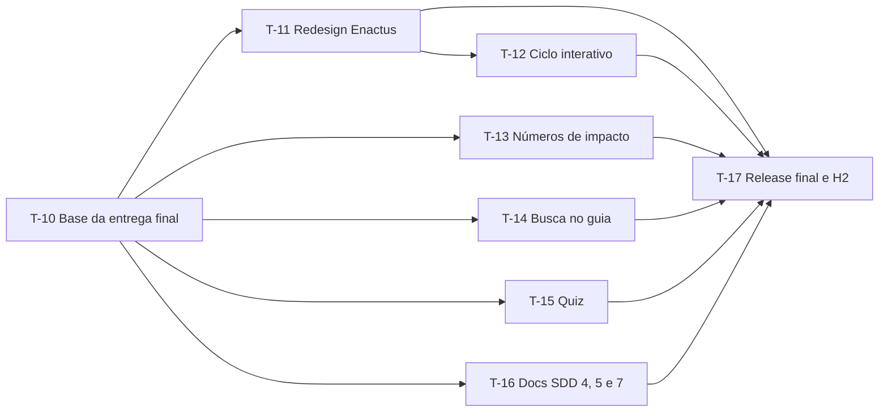

# Plano de tarefas da entrega final (Fase 6, continuação)

| Campo | Valor |
|---|---|
| Projeto | SocialTech (UCB + Projeto Enactus) |
| Fase SDD | 6 (Plano de tarefas): visual Enactus, capacidades **Should**, Fases 4, 5 e 7 e Homologação 2 |
| Versão | 1.0 (26/10/2026) |
| Status | 🚦 Em revisão pela equipe |
| Base | [Constituição](00-constituicao.md), [Especificação](01-especificacao.md), [Clarificações](02-clarificacoes.md), [Plano do MVP](03-plano-tarefas.md) |

## 0. Como usar este plano

- Vale o mesmo fluxo da seção 0 do [plano do MVP](03-plano-tarefas.md): cada tarefa `T-XX` vira **uma issue** com o rótulo `tarefa` e **um PR** para `develop`, com `Closes #<nº>`.
- O responsável cria a branch a partir de `develop` atualizada (`feature/<nº da issue>-<descrição>`), cola o **prompt de implementação** no agente de IA, revisa o código, roda `npm run verify` e abre o PR.
- O agente de IA **não faz commit nem push**.
- Prazos em horário de Brasília. **Todos os PRs de código abertos até 28/10/2026 (quarta), 12h.** Release final em 28/10, 18h. Homologação 2 (H2) em **29/10/2026 (quinta)**.
- Os guias para a IA de cada pessoa estão em [`docs/equipe/`](../equipe/). Se houver diferença, vale este plano.

### 0.1 Exceção à Definição de Preparado (continua valendo)

A mesma exceção da seção 0.1 do [plano do MVP](03-plano-tarefas.md): as tarefas apontam para capacidades `C-XX` da especificação, e não para `RF`/`RNF`, porque `docs/requisitos.md` é escrito em paralelo (T-16). A T-16 liga cada `C-XX` aos `RF`/`RNF` e preenche a rastreabilidade com as tarefas T-01 a T-17.

## 1. Decisões técnicas

| ID | Decisão | Motivo | Ligada a |
|---|---|---|---|
| ADR-004 (revisado em 26/10/2026) | **Roboto auto-hospedada**: WOFF2 nos pesos 400 e 700, só caracteres latinos (cerca de 44 KB no total), em `src/assets/fontes/`, com `font-display: swap` e a licença SIL OFL 1.1 junto. Sem CDN, sem Google Fonts e sem pacote npm. A pilha de fontes do sistema continua como reserva | A identidade da Enactus usa Roboto (C-12, Q-22). Arquivo no próprio site: sem rastreamento de terceiros e sem dependência nova. Aprovado pelo Pedro em 26/10 (Q-16) | C-12 |
| ADR-007 | **Layout em faixas de largura total**: cada seção do `<main>` ocupa a largura da tela, com o conteúdo centralizado em até `72rem` (`--recuo-lateral`). No celular, uma coluna; a partir de `48rem`, menu no cabeçalho e grades de 2 colunas ou mais | O site estava preso numa coluna de `40rem` também no computador. O estilo segue o de `enactus.org.br` (faixas, amarelo, recorte diagonal escuro) | C-12 |
| ADR-008 | **Interatividade com aprimoramento progressivo**: busca, ciclo interativo e quiz usam `<script>` do próprio componente, sem biblioteca. Sem JavaScript, o conteúdo continua legível (lista do guia, etapas do ciclo); os controles interativos só aparecem quando o script roda | Funciona em celular fraco e com JS bloqueado; nenhuma dependência nova (`AGENTS.md` §4.4) | C-02, C-03b, C-07 |
| — | **Quiz não mede** (Q-12, opção c): não envia, não grava (`localStorage` também não) e não manda evento ao GoatCounter | LGPD e simplicidade; a compreensão é medida pelo Google Forms | C-07, S-04 |

### 1.1 Tokens novos (somam-se aos da seção 1.1 do plano do MVP)

| Token | Valor | Uso |
|---|---|---|
| `--largura-pagina` | `72rem` | Largura máxima do conteúdo no computador |
| `--recuo-lateral` | `max(var(--espaco), calc((100% - var(--largura-pagina)) / 2))` | Recuo lateral das faixas: centraliza o conteúdo sem `<div>` extra |
| `--espaco-faixa` | `clamp(2.5rem, 6vw, 4.5rem)` | Espaço em cima e embaixo de cada faixa |
| `--fonte-base` | `Roboto, system-ui, -apple-system, "Segoe UI", sans-serif` | Fonte do site (ADR-004 revisado) |

`--largura-conteudo` (`40rem`) continua sendo a largura máxima de **parágrafos**, para a leitura não ficar cansativa. Pares de cor permitidos continuam os do MVP; o amarelo pode ser **texto** só sobre `--cor-escura` (7,8:1).

### 1.2 Ordem da página e faixas

| Ordem | Seção | `id` | Fundo da faixa | Tarefa |
|---|---|---|---|---|
| 1 | Cabeçalho: barra branca com logo e menu; destaque amarelo com o título | — (`<header>`) | Branco e amarelo | T-11 |
| 2 | Guia "Pode / Não pode", com busca e item não listado | `guia` | Branco | T-05, T-14 |
| 3 | Onde está a lixeira agora | `ponto-de-coleta` | Cinza (`--cor-fundo-suave`) | T-06, T-11 |
| 4 | Ciclo do resíduo, interativo | `ciclo` | Branco | T-03, T-12 |
| 5 | Números de impacto | `impacto` | Escuro (`--cor-escura`) | T-13 |
| 6 | Quiz | `quiz` | Branco | T-15 |
| 7 | Avalie o projeto | `avaliacao` | Amarelo (`--cor-destaque`) | T-07, T-11 |
| 8 | Seções do painel ("Sobre o projeto" etc.) | `secao-<id>` | Cinza | T-11 |
| 9 | Rodapé com contatos e logo | — (`<footer>`) | Escuro | T-11 |

### 1.3 Contrato de dados (novas coleções)

Mesmas regras da seção 1.3 do [plano do MVP](03-plano-tarefas.md): quem cria a coleção cria, **no mesmo PR**, o schema em `src/content.config.ts`, os campos em `.pages.yml` e a seção em `docs/guia-edicao-conteudo.md`. A T-10 deixa **marcadores** `T-13`, `T-14` e `T-15` nesses três arquivos e em `src/pages/index.astro`. Cada tarefa troca **só os seus**.

| Coleção | Arquivo | Formato | Tarefa |
|---|---|---|---|
| `impacto` | `src/content/impacto.json` | Lista de `{ numero, descricao, fonte }` | T-13 |
| `guiaOrientacao` | `src/content/guia-orientacao.json` | Objeto `{ naoListado? }` (orientação para item fora da lista), lido com `getEntry("guiaOrientacao", "atual")` | T-14 |
| `quiz` | `src/content/quiz.json` | Lista de `{ pergunta, alternativas: texto[] (2 a 4), correta: número da alternativa certa (1 a 4), explicacao }` | T-15 |

Os schemas abaixo foram testados com `npm run verify` em 26/10/2026. Lista vazia (`[]`) gera só um aviso no build ("No items found"), e a seção correspondente não aparece.

```ts
const impacto = defineCollection({
  loader: file("src/content/impacto.json", {
    parser: (texto) =>
      (JSON.parse(texto) as Record<string, unknown>[]).map((item, indice) => ({
        id: String(indice),
        ...item,
      })),
  }),
  schema: z.object({
    numero: z.string().trim().min(1),
    descricao: z.string().trim().min(1),
    fonte: z.string().trim().min(1),
  }),
});

const guiaOrientacao = defineCollection({
  loader: file("src/content/guia-orientacao.json", {
    parser: (texto) => [
      { id: "atual", ...(JSON.parse(texto) as Record<string, unknown>) },
    ],
  }),
  schema: z.object({
    naoListado: z.preprocess(
      vazioParaUndefined,
      z.string().trim().min(1).optional(),
    ),
  }),
});

const quiz = defineCollection({
  loader: file("src/content/quiz.json", {
    parser: (texto) =>
      (JSON.parse(texto) as Record<string, unknown>[]).map((item, indice) => ({
        id: String(indice),
        ...item,
      })),
  }),
  schema: z
    .object({
      pergunta: z.string().trim().min(1),
      alternativas: z.array(z.string().trim().min(1)).min(2).max(4),
      // Número da alternativa certa, contando a partir de 1 (como aparece no painel).
      correta: z.number().int().min(1),
      explicacao: z.string().trim().min(1),
    })
    .refine((item) => item.correta <= item.alternativas.length, {
      message: "A alternativa certa precisa existir na lista de alternativas.",
      path: ["correta"],
    }),
});
```

## 2. Quem faz o quê

| Pessoa | GitHub | Foco | Tarefas | Guia para a IA |
|---|---|---|---|---|
| Pedro | `@Blima-P` | Base, documentação do SDD, revisão, release e H2 | T-10, T-16, T-17 | — |
| Nicole | `@nicole21carvalho` | Visual: redesign Enactus, ciclo interativo, números de impacto | T-11, T-12, T-13 | [`docs/equipe/nicole.md`](../equipe/nicole.md) |
| Luiz | `@LuizDev1` | Conteúdo e interação: busca no guia, quiz | T-14, T-15 | [`docs/equipe/luiz.md`](../equipe/luiz.md) |
| Demais integrantes | — | Conteúdo com a Enactus, ação no campus, evidências | E-06 a E-10 (seção 4) | — |

## 3. Tarefas de código



A T-13, a T-14 e a T-15 podem começar logo depois da T-10: usam os tokens que já existem e ficam bonitas quando a T-11 entrar. A T-12 mexe no mesmo arquivo que a T-11 (`CicloResiduo.astro`) e **começa depois do merge da T-11**.

### T-10 · Preparar a `develop` para a entrega final

| Campo | Valor |
|---|---|
| Tipo | Configuração / manutenção (chore) |
| Responsável | Pedro |
| Componente | Design system / layout geral; Especificação (docs/SDD) |
| Capacidades | C-12 |
| Depende de | Release do MVP (T-09) |
| Prazo | **26/10/2026, 18h** |
| Validação Enactus | Não |

**Descrição.** Deixar a `develop` pronta para Nicole e Luiz trabalharem ao mesmo tempo, sem mudar nada que apareça no site antes da H1: fontes, marcadores, este plano e os guias da equipe.

**Critérios de aceite**

- [ ] `src/assets/fontes/` tem `roboto-latin-400.woff2`, `roboto-latin-700.woff2` e `LICENSE.txt` (SIL OFL 1.1). Nenhum CSS usa as fontes ainda (a T-11 liga).
- [ ] Marcadores `T-13`, `T-14` e `T-15` em `src/content.config.ts` (definição e export), `.pages.yml` e `docs/guia-edicao-conteudo.md`; `T-13` e `T-15` em `src/pages/index.astro`, entre o ciclo e a avaliação. Cada marcador separado do próximo por uma linha que não muda.
- [ ] Comentários de marcador antigos do MVP removidos.
- [ ] Este plano criado; `01-especificacao.md` e `02-clarificacoes.md` atualizados com Q-12 e Q-16; `03-plano-tarefas.md` §6, `AGENTS.md`, constituição e template de tarefa apontam para este plano.
- [ ] `docs/equipe/nicole.md` e `docs/equipe/luiz.md` reescritos para as novas tarefas.
- [ ] `npm run verify` passa e o site publicado não muda.

**Arquivos previstos:** `src/assets/fontes/*`, `src/pages/index.astro`, `src/content.config.ts`, `.pages.yml`, `docs/guia-edicao-conteudo.md`, `docs/sdd/*.md`, `docs/equipe/*.md`, `AGENTS.md`, `.github/ISSUE_TEMPLATE/tarefa.yml`.

### T-11 · Redesign visual no estilo Enactus

| Campo | Valor |
|---|---|
| Tipo | Funcionalidade (feat) |
| Responsável | Nicole |
| Componente | Design system / layout geral |
| Capacidades | C-12 |
| Depende de | T-10 |
| Prazo | **27/10/2026, 18h** (PR aberto): a T-12 depende dela |
| Validação Enactus | Sim (uso da marca, na H2) |

**Descrição.** Deixar o site com a cara de `enactus.org.br` e adaptado ao tamanho da tela: Roboto, faixas de largura total, cabeçalho branco com menu e destaque amarelo com recorte diagonal escuro, títulos com traço amarelo, rodapé escuro em duas colunas no computador. Hoje tudo fica numa coluna de `40rem`, até no computador. O código completo, já testado em 360 px e 1366 px, está na seção da T-11 de [`docs/equipe/nicole.md`](../equipe/nicole.md).

**Critérios de aceite**

- [ ] Roboto 400 e 700 carregam de `src/assets/fontes/` (DevTools → Network → Font); nenhuma requisição a outro domínio.
- [ ] Tokens da seção 1.1 em `global.css`; o `main` não tem mais largura máxima; cada seção é uma faixa com o fundo da seção 1.2.
- [ ] Cabeçalho: linha amarela no topo, barra branca com logo e, a partir de `48rem`, menu com links para `#guia`, `#ponto-de-coleta` e `#ciclo`; destaque amarelo com um único `<h1>` e o botão escuro "O que pode ir na lixeira?" (→ `#guia`); recorte diagonal escuro a partir de `48rem`.
- [ ] Todo `<h2>` tem o traço amarelo embaixo (menos no rodapé e na faixa amarela da avaliação, onde o traço fica escuro).
- [ ] **360 px:** sem rolagem horizontal; o título do guia aparece sem rolar a tela (até ~400 px do topo), para não prejudicar a meta de 10 s (S-05).
- [ ] **1366 px:** conteúdo centralizado em até `72rem`; guia em 2 colunas; ciclo em linha a partir de `64rem`; rodapé em 2 colunas.
- [ ] Contraste AA mantido; amarelo nunca como texto em fundo claro; foco visível em todos os botões, inclusive nos de fundo escuro e amarelo; alvos ≥ 44 px.
- [ ] Rolagem suave só com `prefers-reduced-motion: no-preference`.
- [ ] Capturas de 360 px e 1366 px no PR.

**Arquivos previstos:** `src/styles/global.css`, `src/components/Cabecalho.astro`, `src/components/Rodape.astro`, `src/components/GuiaPodeNaoPode.astro` (só o `<style>`), `src/components/PontoColeta.astro`, `src/components/CicloResiduo.astro`, `src/components/Avaliacao.astro`, `src/layouts/BaseLayout.astro` (opcional: `<meta name="theme-color">`).

**Prompt de implementação**

```text
Leia AGENTS.md, docs/sdd/05-plano-entrega-final.md (seções 1 e 1.1 a 1.2 e tarefa T-11)
e docs/equipe/nicole.md (seção da T-11, que tem o código completo e testado).
Aplique o código do guia, arquivo por arquivo, sem inventar cores ou tamanhos fora dos tokens.
Em GuiaPodeNaoPode.astro mexa SÓ no <style> (o Luiz mexe no resto na T-14).
Não mude textos nem dados. Não adicione dependências. Não faça commit.
Rode npm run format e npm run verify. Depois, com npm run dev, confira em 360 px e 1366 px:
sem rolagem horizontal, título do guia visível sem rolar no celular, foco visível com Tab.
```

### T-12 · Ciclo do resíduo interativo

| Campo | Valor |
|---|---|
| Tipo | Funcionalidade (feat) |
| Responsável | Nicole |
| Componente | Infográfico do ciclo do resíduo |
| Capacidades | C-03b |
| Depende de | T-11 (merge na `develop`) |
| Prazo | **28/10/2026, 12h** (PR aberto) |
| Validação Enactus | Sim, se houver frases novas do ciclo (Q-03, E-07) |

**Descrição.** Permitir navegar pelo ciclo etapa por etapa (jornada J2), com aprimoramento progressivo (ADR-008): sem JavaScript, continua a lista `<ol>` atual com todas as etapas. Com JavaScript, aparecem os botões das etapas (números), "Anterior" e "Próxima", e só a etapa escolhida fica visível. Fotos dos espaços (Q-05) ficam **fora** desta tarefa: sem fotos autorizadas, o ciclo segue sem imagens (suposição da Q-05).

**Critérios de aceite**

- [ ] Sem JavaScript (DevTools → desativar JS), o ciclo aparece igual ao de hoje, com todas as etapas.
- [ ] Com JavaScript: botões numerados (1 a N) com `aria-label="Etapa X: <nome>"` e `aria-current="step"` na etapa ativa; botões "Anterior" e "Próxima" desabilitados nas pontas; texto "Etapa X de N" com `aria-live="polite"`.
- [ ] Só uma etapa visível por vez (atributo `hidden` nas outras); o leitor de tela anuncia a troca.
- [ ] Navegável por teclado (Tab, Enter, Espaço) e por toque; alvos ≥ 44 px; foco visível.
- [ ] Animação de troca, se houver, só com `prefers-reduced-motion: no-preference`.
- [ ] Os dados continuam vindo de `src/content/ciclo.json`; nada de texto de etapa no código. Com o painel, a ordem e a quantidade de etapas continuam livres.
- [ ] O aviso "Textos do ciclo em validação com a Enactus." continua quando nenhuma etapa tem frase.
- [ ] Testado em 360 px e 1366 px, com capturas no PR.

**Arquivos previstos:** `src/components/CicloResiduo.astro`.

**Prompt de implementação**

```text
Leia AGENTS.md, docs/sdd/05-plano-entrega-final.md (ADR-008 e tarefa T-12) e
docs/equipe/nicole.md (seção da T-12). Trabalhe só em src/components/CicloResiduo.astro.
Mantenha o HTML atual (a <ol> com todas as etapas) como base sem JavaScript.
Acrescente, num <script> do componente (sem biblioteca), um modo "passo a passo":
- botões numerados das etapas, "Anterior", "Próxima" e o texto "Etapa X de N" (aria-live="polite");
- os controles ficam com hidden no HTML e o script os mostra;
- o script põe hidden nas etapas que não estão ativas e marca aria-current="step" no botão ativo;
- vários ciclos na página não devem se misturar (use querySelector a partir da <section>).
Use só tokens de global.css. Alvos de toque com var(--alvo-toque). Sem animação se o usuário
pedir movimento reduzido. Não invente textos de etapa. Não adicione dependências. Não faça
commit. Rode npm run format e npm run verify.
```

### T-13 · Números de impacto

| Campo | Valor |
|---|---|
| Tipo | Funcionalidade (feat) |
| Responsável | Nicole |
| Componente | Números de impacto |
| Capacidades | C-10 |
| Depende de | T-10 |
| Prazo | **28/10/2026, 12h** (PR aberto) |
| Validação Enactus | Não (dados do roteiro); o Prof. Marcus confere na H2 |

**Descrição.** Faixa escura com 4 números grandes em amarelo, cada um com uma frase curta e a fonte, para mostrar por que o descarte correto importa. Os dados são **só** os do roteiro (especificação §1.1); toda estatística cita a fonte. O Prof. Marcus pode editar pelo painel.

Conteúdo inicial de `src/content/impacto.json`:

| Número | Descrição | Fonte |
|---|---|---|
| 81 milhões de toneladas | de resíduos sólidos urbanos foram gerados no Brasil em 2024. | ABREMA, 2025 |
| 0,4% | desses resíduos foi para a compostagem (cerca de 300 mil toneladas). | ABREMA, 2025 |
| 2.147,5 toneladas por dia | de rejeitos chegaram ao Aterro Sanitário de Brasília em 2025. | SLU, 2025 |
| 68,2% | dos domicílios de Taguatinga separavam o lixo orgânico do reciclável. | PDAD 2021 (IPEDF) |

**Critérios de aceite**

- [ ] `src/content/impacto.json` com os 4 itens acima, exatamente; schema da seção 1.3 em `content.config.ts`; bloco `impacto` no `.pages.yml` (lista, 3 campos obrigatórios); seção "8. Números de impacto" no guia de edição.
- [ ] `src/components/NumerosImpacto.astro`: `<section id="impacto" aria-labelledby="titulo-impacto">` com `<h2>` "Por que separar o lixo orgânico?", fundo `--cor-escura`, número em `--cor-destaque`, descrição e fonte em `--cor-fundo` (fonte com tamanho menor).
- [ ] Lista semântica (`<ul>` ou `<dl>`): 1 coluna no celular, 2 a partir de `48rem`, 4 a partir de `64rem`.
- [ ] Se a lista estiver vazia, a seção não aparece.
- [ ] Marcadores `T-13` trocados em `index.astro`, `content.config.ts`, `.pages.yml` e no guia de edição.
- [ ] Sem animação de contagem (números estáticos, legíveis por leitor de tela).
- [ ] Testado em 360 px e 1366 px, com capturas no PR.

**Arquivos previstos:** `src/content/impacto.json`, `src/components/NumerosImpacto.astro`, `src/content.config.ts`, `.pages.yml`, `src/pages/index.astro`, `docs/guia-edicao-conteudo.md`.

**Prompt de implementação**

```text
Leia AGENTS.md, docs/sdd/05-plano-entrega-final.md (seções 1.2 e 1.3 e tarefa T-13) e
docs/equipe/nicole.md (seção da T-13).
1. Crie src/content/impacto.json com os 4 itens da tabela da T-13, exatamente como estão.
2. Troque os marcadores T-13 de src/content.config.ts pelo schema "impacto" da seção 1.3
   (definição e export).
3. Troque o marcador T-13 do .pages.yml por um bloco "impacto" (type: file, list: true,
   campos numero, descricao e fonte, obrigatórios, com rótulos em português simples).
4. Crie src/components/NumerosImpacto.astro (faixa escura, número amarelo, descrição e fonte
   claras; 1, 2 e 4 colunas). Não renderize nada se a lista estiver vazia.
5. Troque os marcadores T-13 de src/pages/index.astro pelo import e pelo componente.
6. Troque o marcador T-13 de docs/guia-edicao-conteudo.md pela seção "8. Números de impacto".
Não invente números nem fontes. Sem dependência nova. Não faça commit. Rode npm run format
e npm run verify.
```

### T-14 · Busca no guia e item não listado

| Campo | Valor |
|---|---|
| Tipo | Funcionalidade (feat) |
| Responsável | Luiz |
| Componente | Guia "Pode / Não Pode" |
| Capacidades | C-02 |
| Depende de | T-10 |
| Prazo | **28/10/2026, 12h** (PR aberto) |
| Validação Enactus | Sim (texto do item não listado, Q-02, E-06) |

**Descrição.** Um campo de busca filtra os itens do guia enquanto a pessoa digita, sem diferenciar acento e maiúscula ("citrica" acha "Frutas cítricas"). Embaixo do guia, uma caixa "Não achou seu item?" mostra a orientação da Enactus para item fora da lista. Enquanto a Enactus não responder a Q-02, a caixa mostra "Orientação para itens fora da lista em validação com a Enactus." Nada do que é digitado é guardado ou enviado.

**Critérios de aceite**

- [ ] Sem JavaScript, o guia aparece completo e o campo de busca não aparece (`hidden` no HTML, o script mostra).
- [ ] `<label>` visível "Procure um item" ligado a um `<input type="search">`; altura ≥ 44 px.
- [ ] O filtro ignora acentos e maiúsculas (`normalize("NFD")` e remoção das marcas), procura no nome **e** no motivo e atua nos dois grupos ("Pode" e "Não pode").
- [ ] Um texto com `aria-live="polite"` informa quantos itens foram encontrados; com zero resultados, mostra "Nenhum item encontrado." e a caixa "Não achou seu item?" continua visível.
- [ ] Coleção `guiaOrientacao` da seção 1.3, com `src/content/guia-orientacao.json` inicial `{ "naoListado": "" }`, bloco no `.pages.yml` (objeto único, campo de texto opcional) e seção "9. Item fora da lista do guia" no guia de edição.
- [ ] Nada do que é digitado vai para `localStorage`, URL, GoatCounter ou qualquer serviço.
- [ ] Em `GuiaPodeNaoPode.astro`, as regras `section { margin-block … }` e `h2 { margin … }` do `<style>` **não são tocadas** (a T-11 as remove), para não dar conflito.
- [ ] Testado em 360 px e 1366 px, com capturas no PR.

**Arquivos previstos:** `src/components/GuiaPodeNaoPode.astro`, `src/content/guia-orientacao.json`, `src/content.config.ts`, `.pages.yml`, `docs/guia-edicao-conteudo.md`.

**Prompt de implementação**

```text
Leia AGENTS.md, docs/sdd/05-plano-entrega-final.md (ADR-008, seção 1.3 e tarefa T-14) e
docs/equipe/luiz.md (seção da T-14).
1. Troque os marcadores T-14 de src/content.config.ts pelo schema "guiaOrientacao" da seção
   1.3 e crie src/content/guia-orientacao.json com { "naoListado": "" }.
2. Troque o marcador T-14 do .pages.yml por um bloco "guiaOrientacao" (type: file, sem list,
   campo naoListado do tipo text, opcional, rótulo "Orientação para item fora da lista").
3. Em src/components/GuiaPodeNaoPode.astro:
   - acrescente, logo abaixo do <h2>, um <label> + <input type="search"> com hidden, e um
     <p aria-live="polite"> para a contagem;
   - num <script> do componente (sem biblioteca), mostre o campo e filtre os <li> pelo nome e
     pelo motivo, ignorando acentos e maiúsculas; esconda com o atributo hidden;
   - abaixo dos grupos, a caixa "Não achou seu item?" com o texto de naoListado
     (getEntry("guiaOrientacao", "atual")) ou o aviso de pendência.
   Não mexa nas regras "section" e "h2" do <style>.
4. Troque o marcador T-14 de docs/guia-edicao-conteudo.md pela seção "9. Item fora da lista do guia".
Não guarde nem envie o que for digitado. Não invente regra de descarte. Sem dependência nova.
Não faça commit. Rode npm run format e npm run verify.
```

### T-15 · Quiz educativo

| Campo | Valor |
|---|---|
| Tipo | Funcionalidade (feat) |
| Responsável | Luiz |
| Componente | Quiz |
| Capacidades | C-07 |
| Depende de | T-10; perguntas validadas pela Enactus (E-08) para publicar |
| Prazo | **28/10/2026, 12h** (PR aberto) |
| Validação Enactus | Sim (perguntas e gabarito, Q-06) |

**Descrição.** Quiz curto (jornada J3): para cada pergunta, a pessoa escolhe uma alternativa, vê se acertou ("Certo" ou "Errado", com texto **e** símbolo) e a explicação. No fim, "Você acertou X de Y" e o botão "Refazer". O quiz não mede nada (Q-12): não envia, não grava e não conta evento. Enquanto as perguntas não forem validadas, `src/content/quiz.json` fica `[]` e a seção **não aparece**, como a avaliação sem link.

**Critérios de aceite**

- [ ] Coleção `quiz` da seção 1.3 com `src/content/quiz.json` igual a `[]`; bloco `quiz` no `.pages.yml` (lista; `pergunta` texto; `alternativas` lista de 2 a 4 textos; `correta` número; `explicacao` texto; todos obrigatórios) e seção "10. Quiz" no guia de edição, explicando que `correta` é o número da alternativa (1 para a primeira).
- [ ] `src/components/Quiz.astro`: `<section id="quiz" aria-labelledby="titulo-quiz">` com `<h2>` "Teste o que você aprendeu"; cada pergunta é um `<fieldset>` com `<legend>` e alternativas em `<input type="radio">` + `<label>` (alvo ≥ 44 px).
- [ ] Botão "Responder" por pergunta. O resultado aparece numa região `aria-live="polite"`: "✓ Certo" em `--cor-pode` ou "✕ Errado" em `--cor-nao-pode` (símbolo com `aria-hidden`), seguido da explicação; as alternativas ficam travadas.
- [ ] Depois da última pergunta: "Você acertou X de Y." e o botão "Refazer", que limpa tudo e volta o foco à primeira pergunta.
- [ ] Sem JavaScript: as perguntas aparecem e um `<noscript>` explica que é preciso JavaScript para ver as respostas.
- [ ] Nenhum envio, `localStorage`, cookie ou evento do GoatCounter.
- [ ] Com `quiz.json` vazio, a seção não aparece; testado também com 3 perguntas **de exemplo locais** (não commitadas).
- [ ] Marcadores `T-15` trocados em `index.astro`, `content.config.ts`, `.pages.yml` e no guia de edição.
- [ ] Testado em 360 px e 1366 px, com capturas no PR.

**Arquivos previstos:** `src/content/quiz.json`, `src/components/Quiz.astro`, `src/content.config.ts`, `.pages.yml`, `src/pages/index.astro`, `docs/guia-edicao-conteudo.md`.

**Prompt de implementação**

```text
Leia AGENTS.md, docs/sdd/05-plano-entrega-final.md (ADR-008, seção 1.3 e tarefa T-15) e
docs/equipe/luiz.md (seção da T-15).
1. Troque os marcadores T-15 de src/content.config.ts pelo schema "quiz" da seção 1.3 e crie
   src/content/quiz.json com [].
2. Troque o marcador T-15 do .pages.yml por um bloco "quiz" (type: file, list: true; campos
   pergunta, alternativas (string com list: { min: 2, max: 4 }), correta (number) e explicacao).
3. Crie src/components/Quiz.astro: se não houver perguntas, não renderiza nada. Cada pergunta
   é um <fieldset> com <legend> e radios; botão "Responder"; feedback "✓ Certo" / "✕ Errado"
   com texto e símbolo + explicação em aria-live; resultado final "Você acertou X de Y." e
   botão "Refazer". Use um <script> do componente, sem biblioteca, e leia o gabarito de
   data-atributos gerados no build. Inclua <noscript>.
4. Troque os marcadores T-15 de src/pages/index.astro pelo import e pelo componente.
5. Troque o marcador T-15 de docs/guia-edicao-conteudo.md pela seção "10. Quiz".
Não envie nem grave respostas. Não invente perguntas no quiz.json. Sem dependência nova.
Não faça commit. Rode npm run format e npm run verify.
```

### T-16 · Documentação do SDD: requisitos, arquitetura e revisão (Fases 4, 5 e 7)

| Campo | Valor |
|---|---|
| Tipo | Documentação (docs) |
| Responsável | Pedro |
| Componente | Especificação (docs/SDD) |
| Capacidades | Todas |
| Depende de | T-10 |
| Prazo | **28/10/2026, 18h** (merge junto da release) |
| Validação Enactus | Não |

**Descrição.** Escrever os documentos que faltam do SDD, conforme [`PROMPT-SDD.md`](PROMPT-SDD.md) §7 (Fases 4, 5 e 7) e §8: `docs/requisitos.md`, `docs/arquitetura.md` e `docs/sdd/04-revisao.md`. Eles descrevem o que já foi construído e o que entra nesta entrega, e servem de evidência para o relatório.

**Critérios de aceite**

- [ ] `docs/requisitos.md`: RF com Gherkin, RNF mensuráveis (peso da página, Lighthouse, WCAG 2.1 AA, 360 px, 44 px, LGPD), RN, RC com quem fornece e status, histórias de usuário e matriz de rastreabilidade Objetivo → RF/RNF → componente → tarefa (T-01 a T-17) → teste.
- [ ] `docs/arquitetura.md`: C4 níveis 1 e 2 em Mermaid, ordem da página e faixas, design system (tokens do MVP e da seção 1.1), modelo de dados de todas as coleções, fluxos (QR → guia; quiz; formulário), implantação e reversão, **roteiro de homologação** (constituição §8) e ADR-001 a ADR-008.
- [ ] `docs/sdd/04-revisao.md`: checagem da Fase 7 (objetivos cobertos, RF com critério, nada inventado, conflitos com ADR, termos ambíguos).
- [ ] Links internos dos documentos funcionando (`npm run verify` e CI `links`).

**Arquivos previstos:** `docs/requisitos.md`, `docs/arquitetura.md`, `docs/sdd/04-revisao.md`, `AGENTS.md` (tabela de documentos).

**Prompt de implementação**

```text
Leia AGENTS.md, docs/sdd/PROMPT-SDD.md (seções 7 e 8, Fases 4, 5 e 7), a constituição,
a especificação, as clarificações e os planos 03 e 05.
Escreva docs/requisitos.md (Fase 4), docs/arquitetura.md (Fase 5) e docs/sdd/04-revisao.md
(Fase 7), descrevendo o que está implementado na develop e o que as tarefas T-11 a T-15
entregam. Use os IDs estáveis (RF-XX, RNF-XX, RN-XX, RC-XX, ADR-XXX) e as marcações
[CONFIRMADO]/[SUPOSIÇÃO]/[PENDENTE]. Não invente conteúdo de descarte nem dados.
Atualize a tabela de documentos do AGENTS.md. Não faça commit. Rode npm run verify.
```

### T-17 · Release final e Homologação 2

| Campo | Valor |
|---|---|
| Tipo | Configuração / manutenção (chore) |
| Responsável | Pedro (com a equipe) |
| Componente | QR Code; Contagem de acessos; Formulário de avaliação |
| Capacidades | Todas as **Must** e as **Should** entregues |
| Depende de | T-11 a T-16; E-06 a E-09 |
| Prazo | Merges até **28/10, 16h**; release até **28/10, 18h**; **H2 em 29/10/2026** (horário combinado pelo Pedro com o Prof. Marcus) |
| Validação Enactus | Sim (H2) |

**Descrição.** Revisar e fazer merge dos PRs na `develop`, trazer a `main` para a `develop` (edições do painel), abrir a release `develop` → `main` com **merge commit** (`gh pr merge --merge`), conferir o deploy, conduzir a H2 e registrar as evidências na descrição do PR de release.

**Critérios de aceite**

- [ ] `git merge origin/main` feito na `develop` antes da release.
- [ ] Release com merge commit, publicada até 28/10, 18h.
- [ ] Teste da equipe em 2 celulares antes do merge (constituição §8, depois do QR impresso).
- [ ] Checklist da H2 (abaixo) preenchido e aprovado na descrição do PR de release.
- [ ] Depois da H2: `git merge origin/main` na `develop` de novo, para as duas ficarem iguais.

**Checklist da Homologação 2 (29/10)**

| # | Verificação | Quem aprova |
|---|---|---|
| H2-1 | Abre bem em 2 celulares reais e num computador de 1366 px, sem rolagem horizontal; visual com a identidade Enactus | Equipe; Enactus (marca) |
| H2-2 | A busca acha itens da lista ("cítrica", "CITRICA", "citrica"); um item fora da lista mostra a orientação da Enactus (ou o aviso de pendência) | Equipe; Enactus |
| H2-3 | O ciclo funciona etapa por etapa no toque e no teclado; as etapas e frases estão corretas | Enactus |
| H2-4 | Os números de impacto e as fontes estão corretos | Prof. Marcus |
| H2-5 | O quiz (se publicado) tem perguntas e gabarito validados; não envia nada | Enactus |
| H2-6 | Lighthouse (celular): Acessibilidade ≥ 90; página inicial < 500 KB | Pedro |
| H2-7 | Evidências registradas: acessos do QR no GoatCounter (meta ≥ 150), formulários respondidos (meta ≥ 80), pessoas alcançadas na ação (meta > 300) | Pedro |
| H2-8 | O Prof. Marcus edita pelo painel um número de impacto e uma pergunta do quiz (em rascunho) sem ajuda | Prof. Marcus |

## 4. Tarefas fora do código (equipe sem GitHub)

| ID | Tarefa | Responsável | Prazo | Ligada a |
|---|---|---|---|---|
| E-06 | Pedir à Enactus a **regra para item não listado** (e a lista do que **pode**, se ainda faltar) | A definir pelo Pedro | **28/10, 12h** | Q-01, Q-02, T-14 |
| E-07 | Pedir à Enactus os nomes e as frases de cada etapa do ciclo e, se houver, fotos dos espaços com autorização de uso | A definir pelo Pedro | **28/10, 12h** | Q-03, Q-05, T-12 |
| E-08 | Rascunhar 3 a 5 perguntas do quiz a partir da lista validada (alternativas, gabarito e explicação) e enviar à Enactus para validar; o Prof. Marcus ou o Pedro cadastram no painel | Equipe → Enactus | **28/10, 12h** | Q-06, T-15 |
| E-09 | Ação de conscientização no campus (27 e 28/10): divulgar o QR e o formulário, com contagem de pessoas alcançadas (lista de presença ou contagem documentada) | Equipe | **28/10** | Q-17, S-02, S-03 |
| E-10 | Reunir as evidências para o relatório: prints do GoatCounter, planilha do Forms (sem dados pessoais), fotos da ação, registros da H1 e da H2 | A definir pelo Pedro | **29/10** | S-01 a S-03, roteiro 2.9 |

## 5. Cronograma até a entrega final

| Quando | O quê |
|---|---|
| 26/10 até 18h | T-10 com merge na `develop`; issues T-11 a T-17 criadas e atribuídas |
| 26/10 às 20h | Homologação 1 do MVP (plano 03, T-09) |
| 26/10 18h → 27/10 18h | Nicole: T-11 (prioridade) e T-13. Luiz: T-14 e T-15. Pedro: T-16 e revisão dos PRs |
| 27/10 até 18h | PR da T-11 aberto; merge assim que aprovado |
| 27/10 e 28/10 | Ação no campus (E-09) |
| 27/10 (depois da T-11) → 28/10 12h | Nicole: T-12 |
| 28/10 até 12h | **Todos os PRs de código abertos**; conteúdo da Enactus (E-06 a E-08) no painel |
| 28/10 até 16h | Merges na `develop` |
| 28/10 até 18h | Release final `develop` → `main` (merge commit) e deploy |
| 29/10 | **Homologação 2** e evidências (E-10) |
