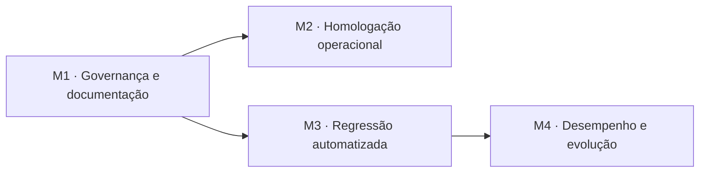

# Plano de encerramento por milestones

| Campo | Valor |
|---|---|
| Projeto | Compostagem Enactus UCB (SocialTech) |
| Versão | 1.1 (12/11/2026) |
| Status | 🚧 M1 e M3 concluídos; M2 aguarda evidências presenciais; M4 aguarda publicação da `develop` |
| Base | [Requisitos](../requisitos.md), [Arquitetura](../arquitetura.md), [Revisão](04-revisao.md) |

## 1. Objetivo

Encerrar o projeto com a documentação coerente com o código, evidências operacionais registradas, regressão automatizada dos fluxos críticos e margem segura no orçamento de desempenho.

Cada milestone tem uma tarefa, uma issue e um PR separado para `develop`.

## 2. Milestones

### T-36 · M1 — Governança e documentação

| Campo | Valor |
|---|---|
| Issue | #99 |
| PR | #100 — mesclado em `develop` |
| Status | ✅ Concluído |
| Requisitos | RNF-14; ADR-002; DT-02 |
| Entrega | Sincronização da `main` na `develop`, SDD atualizado e plano M1–M4 registrado |

**Critérios de aceite**

- [x] A branch parte da `origin/develop` atualizada e integra a versão oficial da `main`.
- [x] O carrossel mobile do ciclo (PR #98) é preservado.
- [x] Requisitos, arquitetura e revisão não mostram funcionalidades concluídas como planejadas.
- [x] Pendências de conteúdo e operação estão consolidadas sem marcar evidência ausente como concluída.
- [x] Este plano e o DoD vigente estão ligados em `AGENTS.md`.
- [x] `npm run verify` passa.

### T-37 · M2 — Homologação operacional

| Campo | Valor |
|---|---|
| Depende de | T-36 |
| Issue / PR | #105 / #106 — registro mesclado em `develop` |
| Status | 🚧 Evidências públicas registradas; testes presenciais e dados da ação pendentes |
| Requisitos | RF-13, RF-14, RF-15; RNF-11, RNF-12, RNF-15 |
| Entrega | Registro verificável de RH-01 a RH-12 e das metas S-01 a S-03 |

**Evidências necessárias**

- QR/adesivo/cartaz impressos e testados em dois celulares;
- modelos e sistemas dos aparelhos, data e resultado;
- acesso correspondente no GoatCounter;
- formulário correto e quantidade de respostas;
- quantidade documentada de pessoas alcançadas;
- edição pelo Pages CMS e tempo até a publicação;
- Lighthouse e teste sem JavaScript.

Dados pessoais não entram no repositório. Capturas devem ocultar identificadores e respostas individuais.

O estado detalhado de RH-01 a RH-12 está no [registro de homologação operacional](../homologacao-operacional.md).

### T-38 · M3 — Regressão automatizada

| Campo | Valor |
|---|---|
| Depende de | T-36 |
| Issue / PR | #101 / #102 — mesclado em `develop` |
| Status | ✅ Concluído |
| Requisitos | RF-01, RF-02, RF-05, RF-11, RF-17; RNF-05, RNF-07, RNF-09, RNF-10, RNF-12 |
| Entrega | Playwright no projeto e no CI, cobrindo os fluxos críticos |

**Critérios de aceite**

- [x] Busca ignora acentos e mostra zero resultados corretamente.
- [x] "Ver mais" expande e recolhe os dois grupos.
- [x] Ciclo funciona por botões, teclado e arraste no celular.
- [x] Quiz revela uma pergunta por vez, calcula o placar e permite refazer.
- [x] Tema segue o sistema, alterna e persiste sem guardar dado pessoal.
- [x] Há testes em 360 px, computador, movimento reduzido e JavaScript desativado.
- [x] Falhas produzem artefatos úteis no CI; o site publicado não recebe Playwright.

### T-39 · M4 — Desempenho e evolução

| Campo | Valor |
|---|---|
| Depende de | T-38 |
| Issue / PR | #103 / #104 — parte técnica mesclada em `develop` |
| Status | 🚧 Medição local aprovada; medição publicada depende da promoção para `main` |
| Requisitos | RNF-01, RNF-02, RNF-16 |
| Entrega | Página inicial com meta interna de até 350 KB e backlog pós-entrega decidido |

**Critérios de aceite**

- [x] O verificador automático usa 350 KB como meta interna.
- [x] Imagens e recursos críticos são otimizados sem perda relevante de legibilidade.
- [ ] Lighthouse publicado registra desempenho ≥ 90 e LCP ≤ 3 s.
- [x] C-14 (fotos/depoimentos da ação) só vira requisito com autorização de uso.
- [x] Questões Q-24 a Q-28 ficam respondidas ou formalmente aceitas como pendência.

## 3. Definição de Pronto do encerramento

Um milestone só fecha quando:

- todos os critérios de aceite têm evidência;
- `npm run verify` e os testes de comportamento passam;
- CI está verde;
- documentação e rastreabilidade foram atualizadas;
- mudanças visuais têm evidência em 360 px e no computador;
- acessibilidade, LGPD e funcionamento sem JavaScript foram verificados quando aplicáveis;
- a issue está ligada ao PR, aprovado por code owner e mesclado em `develop`;
- itens externos sem evidência permanecem explicitamente pendentes.

