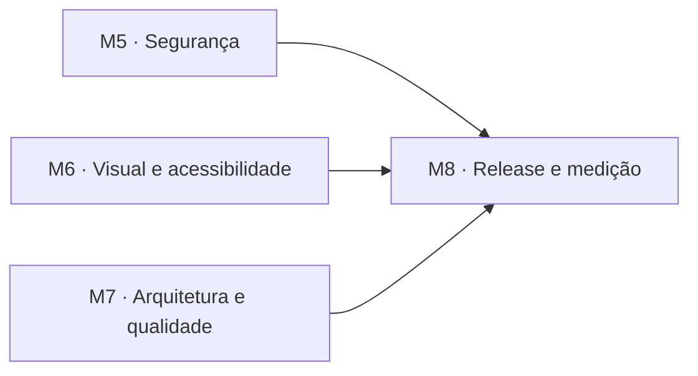

# Plano de melhorias contínuas (M5–M8)

| Campo | Valor |
|---|---|
| Projeto | Compostagem Enactus UCB (SocialTech) |
| Versão | 1.1 (12/11/2026) — achados da revisão rubber duck aplicados |
| Status | 🚧 Em execução |
| Base | [Requisitos](../requisitos.md), [Arquitetura](../arquitetura.md), [Plano M1–M4](08-plano-milestones.md) |

## 1. Objetivo

Depois do encerramento (M1–M4), quatro auditorias independentes revisaram o site publicado e o repositório: segurança, visual e acessibilidade, arquitetura e desempenho/SEO/operação. Cada auditoria usou um modelo de IA diferente. Este plano reúne as melhorias aceitas, uma por tarefa, issue e PR.

Regras do plano:

- uma tarefa por branch (`feature/*`, `fix/*`, `docs/*` ou `chore/*`), a partir da `develop` atualizada;
- nenhuma dependência de runtime nova; o site continua estático e funciona sem JavaScript;
- a meta interna de 350 KB da página inicial (T-39) continua valendo;
- o conteúdo validado pela Enactus não muda.

## 2. Milestones

### M5 · Segurança e cadeia de suprimentos

Reduzir o risco da cadeia de suprimentos (Actions, dependências) e limitar o que um script injetado conseguiria fazer no navegador.

| Tarefa | Issue | Entrega | Requisitos | Status |
|---|---|---|---|---|
| T-40 | #112 | Fixa GitHub Actions por SHA imutável | RNF-14 | ✅ #139 |
| T-41 | #113 | Aplica permissões mínimas por job e checkout sem credenciais | RNF-14 | ✅ #141 |
| T-42 | #114 | Configura Dependabot para npm e GitHub Actions | RNF-14 | ✅ #147 |
| T-43 | #115 | Adiciona revisão de dependências nos PRs | RNF-14 | ✅ #149 |
| T-44 | #116 | Adiciona CSP e política de referenciador | RNF-14, RNF-15 | ✅ #166 |
| T-45 | #117 | Verificador exige noreferrer, CSP e único script remoto | RNF-14 | ✅ #169 |
| T-46 | #118 | Publica a política de segurança | RNF-14, RNF-15 | ✅ #153 |
| T-67 | #142 | Deploy roda o verificador do site antes de publicar | RNF-13, RNF-14 | ✅ #144 |
| T-68 | #171 | Dependabot de Actions também ignora versões major | RNF-14 | ✅ #174 |

**T-40 — critérios de aceite**

- [x] Nenhum `uses:` aponta para tag ou branch; cada SHA leva a versão em comentário (`# vN`).
- [x] Cada SHA confere com a release indicada.
- [ ] CI, links, controle de merge e deploy continuam verdes.
- [x] O `controle-merge-main` mantém `pull_request_target`: ele não faz checkout do PR e não pode ser alterado pelo próprio PR.

**T-41 — critérios de aceite**

- [x] O job `build` tem só `contents: read` e `pages: read` (exigido por `configure-pages`).
- [x] Só o job `deploy` recebe `pages: write` e `id-token: write`.
- [x] Todos os `actions/checkout` usam `persist-credentials: false`.
- [ ] O deploy publica normalmente.

**T-42 — critérios de aceite**

- [x] `.github/dependabot.yml` cobre `npm` e `github-actions`, roda semanalmente e abre PRs para `develop`.
- [x] Patch e minor vêm agrupados; atualizações major ficam fora do Dependabot e são feitas à mão, com revisão; poucos PRs abertos ao mesmo tempo.
- [x] A instalação continua só por `npm ci`.

**T-43 — critérios de aceite**

- [x] Workflow `dependency-review-action` (fixado por SHA) roda nos PRs para `develop` e `main`.
- [x] Falha com vulnerabilidade alta ou crítica.
- [x] Tem `timeout-minutes` e só `contents: read`.
- [x] PR sem mudança de dependência passa.

**T-44 — critérios de aceite**

- [x] A CSP é gerada pelo `security.csp` do Astro, que calcula os hashes dos scripts e estilos no build; nada de hash mantido à mão. Os dois scripts `is:inline` (tema e configuração do GoatCounter), que o Astro não calcula, recebem o hash no `BaseLayout` pelo `Astro.csp.insertScriptHash`, a partir do mesmo texto que vai para a página.
- [x] A CSP tem `default-src 'self'`, `object-src 'none'` e `base-uri 'self'`, além de `script-src` e `style-src` sem `'unsafe-inline'`; libera só `https://gc.zgo.at` (script) e `https://socialtech-ucb.goatcounter.com` (conexão e imagem).
- [x] A meta da CSP vem antes de qualquer `<script>`. O Astro põe a meta no fim do `<head>`, então os scripts do layout ficam no `<body>` (o de tema logo no início, sem piscar).
- [x] `<meta name="referrer" content="strict-origin-when-cross-origin">`.
- [x] O console não registra violação de CSP no build de produção (teste Playwright).
- [x] Tema, guia, ciclo e quiz continuam funcionando; a contagem do GoatCounter é conferida no site publicado (T-66), porque localmente ele não registra visitas.

**T-45 — critérios de aceite**

- [x] Todo `target="_blank"` precisa de `rel` com `noopener` e `noreferrer`.
- [x] O build falha sem CSP, com CSP incompleta (`default-src`, `object-src`, `base-uri`) ou com `'unsafe-inline'`, com `<script>` antes da meta da CSP ou sem a política de referenciador (`strict-origin-when-cross-origin` ou mais restrita).
- [x] O único script remoto aceito é `https://gc.zgo.at/count.js`.
- [x] O link da avaliação passa a usar `noopener noreferrer`.

**T-46 — critérios de aceite**

- [x] `SECURITY.md` em português aponta para o relato privado de vulnerabilidades do GitHub e pede que não se publique dado pessoal em issue.
- [x] O relato privado de vulnerabilidades está ativado no repositório.
- [x] Nenhum e-mail pessoal ou segredo é publicado.

**T-67 — critérios de aceite**

- [x] O workflow de deploy roda `npm run verificar:site` depois do build e antes de enviar o artefato.
- [x] Um site que falha no verificador não é publicado.

**T-68 — critérios de aceite**

- [x] O ecossistema `github-actions` ignora `version-update:semver-major`, como o npm.
- [x] O #151 (upload-artifact 6 → 7) é fechado; a atualização major fica para revisão manual.

### M6 · Visual e acessibilidade

Corrigir lacunas de WCAG 2.1 AA e de leitura rápida no celular, sem mudar o conteúdo validado pela Enactus.

| Tarefa | Issue | Entrega | Requisitos | Status |
|---|---|---|---|---|
| T-47 | #119 | Adiciona link "Pular para o conteúdo" | RNF-05, RNF-06 | ✅ #143 |
| T-48 | #120 | Campo de busca usa as cores do tema e mostra exemplo | RF-02, RNF-05 | ✅ #146 |
| T-49 | #121 | Botão "Limpar busca" com alvo de toque | RF-02, RNF-05 | ✅ #154 |
| T-50 | #122 | Botão desabilitado continua parecendo botão e setas navegam as etapas | RF-05, RNF-05 | ✅ #156 |
| T-51 | #123 | Destaca a alternativa escolhida e foca o feedback só por teclado | RF-17, RNF-05 | ✅ #157 |
| T-52 | #124 | Alterna o fundo de seções vizinhas | RNF-07, ADR-007 | ✅ #159 |
| T-53 | #125 | Atalhos sublinhados, espaçados e com alvo de toque | RNF-05 | ✅ #161 |
| T-54 | #126 | Versão para impressão com todo o conteúdo | RNF-10 | ✅ #163 |
| T-71 | #176 | Anel de foco visível no atalho da etapa atual no tema escuro | RNF-05 | ✅ #177 |

**T-47 — critérios de aceite**

- [x] O primeiro Tab foca "Pular para o conteúdo", visível e com no mínimo 44 px.
- [x] Enter leva o foco para o `main`.
- [x] Fora do foco, o link não ocupa espaço nem gera CLS.
- [x] Teste Playwright cobre o fluxo.

**T-48 — critérios de aceite**

- [x] Nos dois temas, o campo usa `--cor-fundo` e `--cor-texto`.
- [x] O placeholder dá exemplo, tem contraste AA e não substitui o rótulo.
- [x] Teste Playwright no tema escuro.

**T-49 — critérios de aceite**

- [x] "Limpar busca" só aparece quando há texto e mede no mínimo 44 × 44 px.
- [x] Ao tocar, esvazia o campo, mostra a lista inicial e devolve o foco ao campo.
- [x] Sem JavaScript nada muda (a busca continua oculta).
- [x] Teste Playwright.

**T-50 — critérios de aceite**

- [x] "Anterior" desabilitado mantém contorno e fundo distintos de "Próxima".
- [x] Seta direita/esquerda só move o foco entre os atalhos (com `preventDefault`); Enter ou Espaço ativam a etapa focada. Roving tabindex não é exigido.
- [x] O arraste no celular continua igual.
- [x] O teste do ciclo cobre as setas, e o teste "não anuncia etapas intermediárias" continua passando.

**T-51 — critérios de aceite**

- [x] A alternativa escolhida fica em negrito e com borda reforçada; as não escolhidas ficam esmaecidas com contraste AA.
- [x] O anel de foco do feedback usa `:focus-visible`.
- [x] Teste Playwright.

**T-52 — critérios de aceite**

- [x] Seções vizinhas em `main` nunca têm o mesmo fundo sem divisória.
- [x] O contraste dos textos continua AA nos dois temas.
- [x] Teste Playwright percorre as seções; captura em 360 px.

**T-53 — critérios de aceite**

- [x] Os atalhos da 404 têm sublinhado, espaço entre si e no mínimo 44 px de altura.
- [x] Teste Playwright em `/SocialTech/404.html`.

**T-54 — critérios de aceite**

- [x] Na impressão, todos os cartões do guia e as cinco etapas do ciclo aparecem, inclusive os que o JavaScript esconde com `hidden`.
- [x] Tema, busca, "Ver mais", navegação do ciclo e quiz ficam ocultos.
- [x] Fundos escuros viram texto escuro sobre branco.
- [x] Teste Playwright com `emulateMedia({ media: "print" })`.

**T-71 — critérios de aceite**

- [x] No `:focus-visible` dos botões do ciclo, o anel usa `var(--cor-texto)`, com contraste ≥ 3:1 contra o fundo nos dois temas (era 1,39:1 no escuro).
- [x] Teste Playwright mede o contraste do anel do atalho atual nos dois temas e falha sem a correção.

### M7 · Arquitetura e qualidade

Fazer o painel, o verificador e os testes pegarem erros antes da publicação, e manter os documentos de agentes fiéis ao código.

| Tarefa | Issue | Entrega | Requisitos | Status |
|---|---|---|---|---|
| T-55 | #127 | Ordena dúvidas e links pelo id numérico | RF-14, RF-16 | ✅ #140 |
| T-56 | #128 | Painel aplica as regras do schema que ele consegue expressar | RF-14, RNF-11 | ✅ #165 |
| T-57 | #129 | Troca asserções não nulas por checagem explícita | RNF-14 | ✅ #158 |
| T-58 | #130 | Exige 404.html e âncoras internas existentes | RNF-13, RNF-14 | ✅ #160 |
| T-59 | #131 | Todo item de guia.json aparece no HTML | RF-01, RF-14 | ✅ #162 |
| T-60 | #132 | Cobre a página 404 e o quiz sem alternativa | RF-17, RNF-13 | ✅ #164 |
| T-61 | #133 | Alinha AGENTS.md com código e CI | RNF-14 | ✅ #168 |
| T-69 | #172 | Guia conferido só na seção do guia e sitemap com URL exata | RF-01, RF-14, RNF-04, RNF-14 | ✅ #175 |
| T-72 | #178 | Quiz lê o gabarito do JSON e anúncios esperam o fim da rolagem | RF-14, RF-17, RNF-14 | ✅ #179 |

**T-55 — critérios de aceite**

- [x] `DuvidasComuns` e `ListaLinks` ordenam por `Number(id)`, como os outros componentes.
- [x] A ordem no HTML segue a do JSON.

**T-56 — critérios de aceite**

- [x] O `.pages.yml` usa `pattern`, `minlength` e `min`/`max` só onde a regra do zod tem equivalente direto.
- [x] Regras que o painel não expressa ficam só no zod e no `npm run verify`, com texto de ajuda no campo: o `endereco` dos links (união de formatos, sem `pattern` único) e `correta ≤ número de alternativas` (o painel aceita `correta` com mínimo 1).
- [x] Nenhum valor aceito pelo zod é recusado pelo painel.
- [x] O `content.config.ts` indica o campo correspondente no painel.

**T-57 — critérios de aceite**

- [x] Uma função `exigir` (`src/scripts/exigir.ts`), usada pelos três scripts, lança erro com o seletor.
- [x] Não sobra `!` de asserção não nula nos scripts de cliente.
- [x] `npm run verify` e o e2e passam.

**T-58 — critérios de aceite**

- [x] O build falha sem `dist/404.html`.
- [x] Todo `href` interno com `#` precisa apontar para um `id` existente na página de destino. O verificador resolve o arquivo de destino: os atalhos da 404 apontam para âncoras da página inicial.
- [x] Só `node:fs`, sem dependência nova.

**T-59 — critérios de aceite**

- [x] O verificador lê `src/content/guia.json` e exige cada `nome` em `dist/index.html`.
- [x] Falha citando o item ausente.

**T-60 — critérios de aceite**

- [x] A 404 mostra o `h1`, o link para o início e os atalhos.
- [x] "Responder" sem alternativa mostra o aviso e não avança.
- [x] Os dois projetos Playwright passam.

**T-61 — critérios de aceite**

- [x] As três afirmações batem com `astro.config.mjs`, a árvore `src/` e o `ci.yml`.

**T-69 — critérios de aceite**

- [x] Os nomes do guia são procurados só dentro de `#guia` (o quiz repete alguns, como "Borra de café").
- [x] Os textos do JSON passam por `trim()` antes da comparação, como no schema.
- [x] O sitemap precisa listar exatamente a URL canônica da página inicial.
- [x] Testes do verificador cobrem cada caso e falham sem a correção.

**T-72 — critérios de aceite**

- [x] Os testes do quiz leem alternativas e gabarito de `src/content/quiz.json` (import JSON com `with { type: "json" }`).
- [x] O teste de anúncios só confere a lista depois que a rolagem chega à última etapa.
- [x] Com uma alternativa editada no JSON, o teste antigo falha e o novo passa.

### M8 · Desempenho, SEO e operação

Tornar builds reproduzíveis, melhorar a descoberta pela busca e detectar falhas no site publicado entre um PR e outro.

| Tarefa | Issue | Entrega | Requisitos | Status |
|---|---|---|---|---|
| T-62 | #134 | Fixa a versão do Node em .nvmrc | RNF-14 | ✅ #145 |
| T-63 | #135 | Publica sitemap da página canônica | RNF-04 | ✅ #167 |
| T-64 | #136 | Dados estruturados das dúvidas comuns | RNF-04, RF-16 | ❌ não planejada (seção 3) |
| T-65 | #137 | Monitora o site publicado e os links externos toda semana | RNF-13 | ✅ #155 |
| T-73 | #180 | Guia explica o limite de peso e lychee com tentativas limitadas | RNF-01, RNF-13 | ✅ #181 |
| T-66 | #138 | Publica M5–M8 e registra Lighthouse publicado | RNF-01, RNF-02, RNF-03 | ⏳ |

**T-62 — critérios de aceite**

- [x] O `.nvmrc` define a versão; os workflows usam `node-version-file`.
- [x] O README e o CONTRIBUTING citam o `.nvmrc`.
- [ ] CI e deploy passam.

**T-63 — critérios de aceite**

- [x] `/SocialTech/sitemap.xml` é XML válido com a URL canônica e sem a 404, gerado por um endpoint estático (`src/pages/sitemap.xml.ts`), sem dependência nova.
- [x] O verificador exige o sitemap.
- [x] A arquitetura explica por que não há `robots.txt` e que o sitemap é enviado à mão no Search Console.

**T-65 — critérios de aceite**

- [x] Um workflow agendado e manual confere: início retorna 200 com o título esperado; rota inexistente retorna 404 com a página de erro; Lychee valida os links do site publicado.
- [x] Permissões `contents: read` e `issues: write`; em falha, abre ou comenta uma única issue de alerta.
- [x] Timeout e tentativas limitadas.
- [x] A documentação avisa que o GitHub desativa workflows agendados após 60 dias sem atividade no repositório.

**T-73 — critérios de aceite**

- [x] O guia de edição (§12) cita o limite de peso como motivo de a mudança não aparecer, explica que o site já reduz cada foto e orienta a avisar o responsável técnico.
- [x] O lychee do monitoramento usa `--max-retries 3` e `--timeout 30`.

**T-66 — critérios de aceite**

- [ ] Deploy verde; o site publicado tem CSP sem violações.
- [ ] Lighthouse mobile publicado: desempenho ≥ 90, LCP ≤ 3 s, CLS ≤ 0,1, acessibilidade ≥ 90.
- [ ] Requisitos, arquitetura e este plano registram a medição; #103 é fechada.

## 3. Propostas avaliadas e não incluídas

| Proposta | Decisão | Motivo |
|---|---|---|
| Trocar `pull_request_target` por `pull_request` no controle de merge | Rejeitada | O workflow não faz checkout nem executa código do PR. Com `pull_request`, o próprio PR poderia alterar o check obrigatório `aprovacao-main`. A T-40 fixa a Action por SHA. |
| Ajustar métricas da fonte de fallback (`size-adjust`) | Adiada | Depois da correção do botão de tema (#110), o CLS medido não vem da troca de fonte. Reavaliar se o Lighthouse publicado da T-66 mostrar deslocamento ligado à fonte. |
| Lighthouse CI com limites no pipeline | Adiada | Precisa de ferramenta nova no CI e a variação entre execuções gera falsos alarmes. A T-66 registra a medição publicada manualmente, como na T-39. |
| T-64 · JSON-LD `FAQPage` das dúvidas comuns | Não planejada (#136) | Exigiria `set:html`, proibido no projeto. Desde 2023 o Google só mostra rich result de FAQ para sites de governo e saúde, então o ganho seria nulo. |
| `security.txt` em `/.well-known/` | Rejeitada | O site fica sob `/SocialTech/`, e a RFC 9116 exige o arquivo na raiz do domínio, que pertence ao GitHub. O `SECURITY.md` e o relato privado do GitHub cobrem o canal (T-46). |
| Regra de proteção e 2FA para edições do painel na `main` | Recomendação | Depende de configuração da organização e de cada pessoa editora; fica para a equipe responsável, fora do código. |

## 4. Definição de Pronto (M5–M8)

Uma tarefa só fecha quando:

- todos os critérios de aceite da issue têm evidência no PR;
- `npm run verify` e `npm run test:e2e` passam localmente e o CI (`lint`, `links`) está verde;
- comportamento novo ou corrigido tem teste que falharia sem a mudança;
- mudança visual tem captura em 360 px no PR;
- acessibilidade (teclado, contraste AA, alvos de 44 px), LGPD e funcionamento sem JavaScript foram verificados quando aplicáveis;
- a página inicial continua abaixo de 350 KB;
- a issue está ligada ao PR (`Closes #N`) e o PR foi mesclado em `develop` por squash;
- a documentação afetada (requisitos, arquitetura, AGENTS.md, este plano) foi atualizada.

Um milestone só fecha quando:

- todas as tarefas dele fecharam;
- uma revisão rubber duck com pelo menos dois modelos diferentes analisou o diff consolidado do milestone;
- os achados relevantes viraram correção ou ficaram registrados como pendência com motivo.

## 5. Revisão rubber duck

| Etapa | O que é revisado | Modelos |
|---|---|---|
| Plano | Este documento e as issues #112–#138 | dois modelos diferentes dos usados nas auditorias |
| M5–M7 | Diff de cada milestone já mesclado em `develop` | dois modelos por milestone, alternando entre fornecedores |
| Release | Diff `main`…`develop` antes da T-66 | um modelo que ainda não revisou o milestone |

Os achados ficam registrados no PR correspondente ou em PR de correção próprio.

### 5.1 Revisão do plano (v1.0 → v1.1)

Dois modelos revisaram a v1.0: Claude Sonnet 5.5 e GPT-5.3 Codex. Os achados aceitos estão nesta versão:

| Achado | Mudança |
|---|---|
| Hash manual da CSP quebra a cada mudança de script | T-44 usa `security.csp` do Astro e inclui `style-src` |
| `configure-pages` precisa ler a configuração do Pages | T-41 dá `pages: read` ao build |
| O deploy publicava sem rodar o verificador | Nova T-67 (#142) |
| Majors do Dependabot quebram o build sem revisão | T-42 ignora majors |
| `security.txt` sob subcaminho não vale pela RFC 9116 | T-46 sem `security.txt` |
| O painel não expressa regras cruzadas nem uniões | T-56 limitada ao que o painel suporta |
| Setas que trocam de etapa anunciam etapas intermediárias | T-50: setas só movem o foco |
| A impressão não mostra itens com `hidden` | T-54 sobrescreve `hidden` |
| Âncoras da 404 apontam para outra página | T-58 resolve o arquivo de destino |
| JSON-LD de FAQ exige `set:html` e não gera rich result | T-64 não planejada |
| Workflow agendado sem alerta passa despercebido | T-65 abre issue em falha |

O Codex também sugeriu manter a T-64 depois da T-63. Ficou de fora pelos motivos da seção 3.

### 5.2 Revisão dos milestones M5–M8

Três modelos revisaram o diff consolidado `main`…`develop` (M5 a M8), cada um com um foco: Gemini 4 Argon (segurança e CI), Grok 4.7 (visual e acessibilidade) e GPT-6.1 Terra (arquitetura e testes). Nenhum achado bloqueava a release. O Gemini conferiu byte a byte os hashes da CSP com os scripts gerados e não achou brecha nos workflows.

| Achado | Modelos | Decisão |
|---|---|---|
| Dependabot de Actions abria atualização major (#151) | Gemini | Corrigido na T-68 (#174); #151 fechado |
| Guia procurado no HTML inteiro (o quiz repete nomes), sem `trim()` | GPT, Gemini | Corrigido na T-69 (#175) |
| Sitemap aceitava qualquer URL sob a base | GPT | Corrigido na T-69 (#175) |
| Anel de foco do atalho atual com 1,39:1 no tema escuro | Grok | Corrigido na T-71 (#177) |
| Gabarito do quiz fixo no teste; anúncios conferidos antes do fim da rolagem | GPT | Corrigido na T-72 (#179) |
| Carrossel do ciclo dessincroniza ao estreitar a janela | GPT, Grok | Não reproduz (#173): o navegador faz o re-snap para a etapa ativa, única visível no layout de computador; medido de 1366 para 360 px nas etapas 2, 4 e 5, e um teste com essa troca passou sem mudança no código |
| T-45 ainda fora de `develop` | Gemini | Já resolvido: a revisão começou antes do merge do #169 |

Na release, Claude Sonnet 5.5, que não tinha revisado os milestones, analisou o mesmo diff com foco no risco de deploy: CSP em produção, GoatCounter, caminhos com a base, workflows de deploy e monitoramento. Parecer: **release liberada**.

| Achado (não bloqueante) | Decisão |
|---|---|
| Folga de 19 KB no orçamento; uma edição pelo painel pode barrar o deploy sem a pessoa entender | Guia de edição explica, na T-73 (#181) |
| Lychee sem limite de tentativas e de tempo abre issue falsa | `--max-retries 3 --timeout 30` na T-73 (#181) |
| Falta `robots.txt` com a linha `Sitemap:` | Rejeitado: sob `/SocialTech/` o arquivo não vale (seção 3 e arquitetura) |